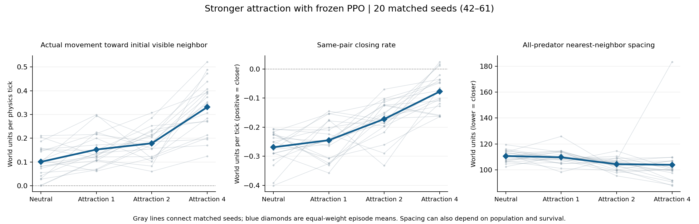

# Stronger attraction: matched-seed sweep

Completed 2026-10-26. Attraction at strength 2 produces closer average
predator spacing than neutral and strength 1. Strength 4 produces a larger
movement-toward-neighbors effect, but its spacing result is less consistent
and its mean predator population is lower. Stable groups remain untested.

## Design and fidelity

- New evaluations: attraction +1 at strengths 2 and 4, 20 matched seeds each (42–61); 40 new episodes total.
- Reused controls: the committed 20-seed neutral and strength-1 attraction results from `movement_s42_61_strength1.json`.
- Frozen checkpoint: `blrep2500_both_learn_s1/checkpoint`; identical policies, environment settings, founder pool and episode seeds.
- A fresh neutral seed-42 episode matched every saved field exactly. Other baseline episodes were reused, not rerun.
- The baseline matches its committed bytes at revision `074595b`; raw inputs, baseline SHA-256, core measurement source hashes and runtime versions are recorded in the combined summary.
- All saved network tensors, constructors/settings and independent actor logits passed validation before and after evaluation. Checkpoint weights, settings and gene-pool hashes stayed unchanged through both strengths.
- CPU inference used one thread at low priority. No PPO training, reward, physics or inheritance changes were made.
- Twenty tests pass. The independent runner re-review found no remaining material correctness concerns; see the review assessment below.

## Condition means

Equal-weight means of 20 episode means. Nearest-neighbor distance uses all
living predators, including unseen ones; world units equal the raw normalized
values multiplied by 400. Projection is toward the neighbor's initial position;
pair closing includes both animals moving and keeps target identity fixed.

| Metric | Neutral | Attraction 1 | Attraction 2 | Attraction 4 |
|---|---:|---:|---:|---:|
| Movement toward initial visible neighbor (world units/tick) | 0.1006 | 0.1523 | 0.1787 | 0.3307 |
| Actual displacement alignment when moving | 0.0443 | 0.0848 | 0.1117 | 0.1956 |
| Same-pair closing rate (positive = closer) | -0.2691 | -0.2449 | -0.1722 | -0.0779 |
| All-predator nearest-neighbor distance (world units) | 110.6174 | 109.6729 | 104.3061 | 103.8368 |
| Mean predator population | 13.5649 | 13.1046 | 13.3736 | 11.7737 |
| Moving-action fraction | 0.3218 | 0.3331 | 0.3227 | 0.3575 |
| Visible-decision fraction | 0.4083 | 0.4259 | 0.4849 | 0.4957 |

## Paired differences from neutral

Exploratory 95% paired percentile bootstrap intervals, 10,000 seed-level
resamples; no adjustment for testing several metrics and strengths.

| Metric | Strength 2 minus neutral [95% interval] | Strength 4 minus neutral [95% interval] |
|---|---:|---:|
| Movement toward initial visible neighbor (world units/tick) | +0.0780 [+0.0482, +0.1074] | +0.2301 [+0.1822, +0.2819] |
| Actual displacement alignment when moving | +0.0674 [+0.0524, +0.0827] | +0.1513 [+0.1322, +0.1731] |
| Same-pair closing rate (positive = closer) | +0.0969 [+0.0634, +0.1284] | +0.1912 [+0.1576, +0.2266] |
| All-predator nearest-neighbor distance (world units) | -6.3113 [-9.3754, -3.1731] | -6.7805 [-13.6784, +3.1003] |
| Mean predator population | -0.1913 [-0.7344, +0.3356] | -1.7912 [-2.7739, -1.0298] |

## What changed

At strength 2, average nearest-neighbor distance falls from 110.62 to
104.31 world units: about **5.7% closer than neutral**. The paired change
is -6.31 units, with interval -9.38 to -3.17. Compared with strength 1,
the change is -5.37 units (-9.18 to -1.65). Thus the spacing result extends
beyond the earlier directional-only finding at strength 1.

Movement toward the visible neighbor's initial position and displacement
alignment both increase relative to neutral. Overall moving-action fraction
is almost unchanged (0.3227 versus 0.3218), while visibility is higher.
These descriptive patterns support a directional change rather than merely
more moving actions. They do not prove the spacing effect is independent
of all trajectory and ecological changes.

Pairs still separate on average: mean closing rate remains negative at
strengths 2 and 4. Both strengths reduce separation relative to neutral,
with intervals excluding zero. Closer overall spatial spacing can coexist
with separation during intervals that begin with a visible neighbor.

At strength 4, mean nearest-neighbor spacing is 103.84 units, but its paired
interval spans both closer and farther spacing (-13.68 to +3.10 units).
The lower mean therefore does not establish a reliable additional spacing
benefit. Mean predator population falls from 13.56 to 11.77; the paired
population difference is -1.79 (-2.77 to -1.03). This is a population signal,
not a demonstrated fitness or survival mechanism.

## Episode lengths and sensitivity

Every strength-2 episode reached the 8000-tick horizon. Strength 4 seed 57
ended after 3517 ticks, with mean predator population 4.34 and mean
nearest-neighbor distance 183.56 units. This episode contributes substantial
variation. The saved neutral seed 42 and strength-1 seed 43 also ended early.

Excluding seeds 42, 43 and 57 from every condition leaves 17 matched seeds.
The strength-2 spacing difference remains negative (-6.09 units; interval
-9.52 to -2.61). Strength 4 also has closer spacing in this restricted set
(-9.70 units; interval -12.83 to -6.62). This is an outcome-selected
sensitivity check, not grounds to discard the early episode or replace the
primary 20-seed conclusion. Strength-4 spacing is sensitive to ecological
trajectory and episode survival.

These experiments use one trained checkpoint and the same seed set as the
pilot; the 40 new attraction episodes are new conditions, not independent
new seeds. Survivor exclusions, varying decision-interval lengths, population
changes and correlated observations remain as described in MOVEMENT_RESULTS.md.
No persistent membership, stable grouping, coordinated hunting or improved
fitness has been measured.

## Independent review and code changes

The first runner review found valid general-input issues: optional checkpoint
files, formatted output-name collisions, baseline validation timing and the
risk of confusing a historical avoidance reference with a new-strength run.
Those safeguards are now addressed. `summarize.py` supports arbitrary named
non-neutral conditions, so new runner summaries contain only the intended
attraction-versus-neutral comparison. Tests cover named conditions, absent
optional files, mismatched baseline seeds and output-name collisions.
The independent re-review found no remaining material correctness concerns;
I agree with its assessment for this known checkpoint and baseline.

The active evaluation started before those runner-only safeguards were updated.
Its source is preserved in `results/strength_sweep_initial_runner.py`. Each raw
strength file therefore retains an explicitly labeled historical avoidance
reference at strength 1. It is **not** avoidance at strength 2 or 4. The combined
summary, tables and figure here omit that historical reference and compare
neutral with attraction strengths 1, 2 and 4 only. Measurement and action code
were unchanged, and no raw experiment outputs were overwritten.

The earlier counterfactual float64/float32 approximation and optimized-Python
assertion follow-ups in REVIEW.md remain open. They do not alter these
standard-interpreter physical movement measurements. The review also notes
that one fresh-neutral replay alone cannot independently certify every saved
baseline episode; immutable committed data and recorded provenance are used
alongside it here.

## Artifacts and next step

- [Combined paired summaries and provenance](results/attraction_strength_sweep_s42_61_summary.json)
- [Strength 2 raw episodes and fidelity checks](results/attraction_s42_61_strength2.json)
- [Strength 4 raw episodes and fidelity checks](results/attraction_s42_61_strength4.json)
- [Previous strength-1 evaluation](MOVEMENT_RESULTS.md)



Use strength 2 for the next visual and persistence checks: inspect trajectories
and measure how long the same neighbors remain close. Before treating this as
stable social grouping or adding inheritance, repeat the promising comparison
on fresh seeds or another frozen trained checkpoint. Increasing strength further
is not the priority suggested by these results.

The runner can be invoked from the repository root with:

```bash
nice -n 10 .conda/bin/python -m predpreygrass.evolutionary.continuous_space.eco_evolutionary_social_preference.strength_sweep \
  predpreygrass/evolutionary/continuous_space/eco_evolutionary_continuous_traits/runs/blrep2500_both_learn_s1/checkpoint \
  --strengths 2 4 --output-dir /tmp/attraction-rerun
```

Choose an unused output directory; existing experiment paths are refused.
