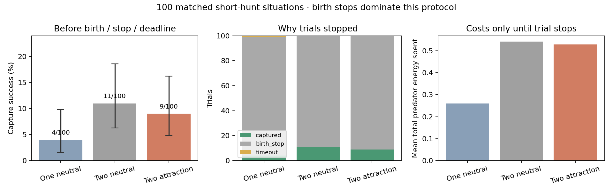

# Controlled short hunts with one or two predators

## Pre-run design

Use the same frozen predator/prey checkpoint (`blrep2500_both_learn_s2`) and
strength-2 attraction, with the original capture, movement, grass, energy,
reproduction and reward rules. Compare 100 matched situations, seeds **202–301**:

1. One predator, neutral preference.
2. Two predators, both neutral.
3. Two predators, both attraction.

The main comparison is two attraction versus two neutral. Adding a predator
provides more hunting effort; an advantage over the solo condition alone is
not evidence that attraction helps, or that predators cooperate.

Each trial lasts at most **256 physics ticks**. Stop at the first capture;
otherwise the first birth, target starvation, loss of all predators, original
environment termination, or the deadline. All trials remain in the denominator.
The endpoint is capture **before a competing stop or the deadline**, not an
estimate of eventual capture probability. Births occur under the original rule;
no reproduction threshold or reward is altered. Stopping at the first birth
keeps subsequent descendants from entering this single-prey test.

### Matched initial state

All arms reset a canonical two-predator/one-prey environment, drawing exactly
the same checkpoint founder genomes. The solo arm then removes only the
companion. This avoids the different gene-RNG draws that separate one/two
population resets would otherwise cause. Focal predator, prey, grass and
birth/gene random states must match exactly; the two-predator arms match their
complete initial states. The reset config still records the canonical two
predators; the actual solo population is explicitly one.

The prey starts at a seeded random translation. Predators are placed at
coordinates `(-d,-40)` and `(-d,+40)` relative to it, rotated by a seeded random
angle; `d` cycles through 80, 120 and 160 across the 100 seeds. These are axial
offsets, not radial distances. Predator headings bisect the bearings to prey
and companion, with original unit initial speed. The focal pose remains
identical in the solo arm. Prey heading is seeded uniform with unit speed.
This deliberately provides nearby partners and potentially visible prey,
rather than waiting for random ecosystem encounters. Initial social visibility
is recorded, not used to select successful situations or retune the design.

These are changed initial conditions, outside the original population setup;
the result is a controlled diagnostic, not an ecological replication.

### Inference and stepping

Each animal uses its own SHA-256-seeded Torch stream, shared across conditions.
Adding a companion therefore does not shift the focal/prey action random
numbers. Neutral/prey actions use the original categorical inference helper;
attraction uses the existing logit bias. This preserves frozen policy
probabilities but intentionally differs from the old shared global sampling
stream, so old ecosystem trajectories are not expected to match.

Actions are held for the saved action-repeat interval. The original
`_physics_step` is called once per tick so the runner can stop precisely at an
event, without simulating the remainder of a decision. A test checks physical state and observations against original `env.step`
over no-event held-action decisions. The direct loop does not reproduce unused
RLlib return aggregation or its `env.agents` bookkeeping; it uses `active` and
current animal observations. Environment source hashes must match the validated 100-episode hunting
baseline. This establishes continuity with those experiments, not historical
training-code equivalence. The unchanged hunting observer records
predator energy costs and verifies each energy ledger.

### Outcomes and analysis

- Capture success before the competing stop/deadline is the main outcome.
- Successful capture tick is recorded. For an all-trial time comparison,
  unsuccessful trials receive a fixed score of 256. This is a penalty score,
  not an imputed capture time. Success-only mean time is descriptive and
  selected on success; it is not a matched causal comparison.
- Total team movement, resting and reproductive energy spent is summed through
  each trial's stopping time. This includes both predators in the two-predator
  arms. Interpret cost jointly with success and duration; early competing
  stops can reduce observed cost without improving hunting efficiency.

Use 10,000 paired situation bootstrap resamples (seed 20261026), with exploratory
95% intervals and no multiplicity adjustment. Also report per-condition Wilson
95% success-rate intervals and discordant capture-pair counts. A bootstrap
contrast interval can collapse when no pairs are discordant; that does not
prove equivalence. Do not analyse interim outcomes or tune the geometry/seeds.

## Reproduce

From the repository root, choose a new output directory:

```bash
nice -n 10 .conda/bin/python -m predpreygrass.evolutionary.continuous_space.eco_evolutionary_social_preference.controlled_hunt \
  predpreygrass/evolutionary/continuous_space/eco_evolutionary_continuous_traits/runs/blrep2500_both_learn_s2/checkpoint \
  --output-dir /tmp/ppg_controlled_hunt_new
```

## Results: birth-limited pilot

**Attraction did not add capture successes over two neutral predators. The
protocol was dominated by prey births, so it does not settle full-length
hunting performance.** All 100 matched situations were run in every arm.

| Outcome | One neutral | Two neutral | Two attraction |
|---|---:|---:|---:|
| Captured before competing stop/deadline | 4/100 | 11/100 | 9/100 |
| Stopped at a birth | 95/100 | 89/100 | 91/100 |
| Reached the 256-tick deadline | 1/100 | 0/100 | 0/100 |
| Mean observed trial ticks | 38.98 | 36.20 | 36.05 |
| Mean total team predator energy spent | 0.2600 | 0.5415 | 0.5285 |
| Mean capture-time penalty score (failure=256) | 247.30 | 230.57 | 235.25 |

There were no starvation or original-environment-ending outcomes in these
300 trials. Birth stops occurred at ticks 10–91, averaging about 37 ticks.
Most of the intended 256-tick opportunity was therefore not observed. The
birth rule was not disabled, nor was the experiment changed after seeing this.

The primary two-attraction minus two-neutral capture difference was **−2
percentage points**, with exploratory paired bootstrap interval **−5 to 0 pp**.
Nine situations captured in both arms, two captured only with neutral
predators, and none captured only with attraction. With only two discordant
pairs, the bootstrap boundary at zero does not establish harm or equivalence.
Individual Wilson 95% capture-rate intervals were 1.6–9.8% (solo), 6.3–18.6%
(two neutral), and 4.8–16.2% (two attraction).

Two neutral predators had more observed captures than one (11 versus 4), but
this alone does not establish a cooperation effect: it adds another predator
and changes the prey's observations and behavior. The exploratory bootstrap
contrast was +7 pp for two versus one (interval +1 to +14 pp). Only eleven
pairs were discordant: nine favored two predators and two favored one.

As an explicitly **post-hoc binary sensitivity check**, exact two-sided
binomial tests of discordant outcomes give p=0.0654 for solo versus two-neutral
and p=0.5 for attraction versus two-neutral. This shows why the small capture
counts should not be overinterpreted from the bootstrap alone. The predeclared
analysis, trials and stopping rules remain unchanged; the sensitivity does
not provide an independent confirmation.

Team energy cost for attraction versus neutral differed by −0.0130 (exploratory
95% interval −0.0414 to +0.0130). There is no clear difference. Two-predator
trials cost approximately twice the solo trials, but costs cover only the
short observed hunt, not 256 ticks or an equal number of successful captures.
Do not interpret lower cost from an early birth stop as greater efficiency.

Success-only mean capture ticks were 38.5, 24.82 and 25.44 respectively.
Those means use different successful subsets (4, 11 and 9 trials) and are
not the main matched time comparison. Attraction minus neutral penalty score
was +4.68 ticks (bootstrap interval 0 to +11.72), again driven by the same
small number of discordant captures rather than strong speed evidence.

Both predators could initially see a companion in all 100 paired situations.
Social opportunities remained present in about 70.1% of two-neutral and 75.3%
of two-attraction predator decisions. Thus attraction had opportunities to
act; its lack of additional captures is not simply due to absent companions.



The first panel shows Wilson intervals for per-condition capture rates. The
middle panel highlights the dominant competing birth stop. Energy bars in
the last panel are descriptive means, with paired cost uncertainty reported
above. None of these plots establishes coordinated hunting.

### Interpretation

This pilot supports no positive attraction effect on the measured short-hunt
endpoint. It also reveals a limitation in this proposed diagnostic: keeping
existing reproduction rules while stopping at the first birth usually truncates
the hunt within roughly 37 ticks. This is useful protocol information, but
not a clean answer about what happens during a full 256-tick pursuit.
The earlier ecosystem and hunting-rate results should remain the stronger
basis for the current conclusion of no demonstrated performance benefit.

A longer isolated chase would require a separately specified way to handle
prey reproduction or resource availability. No such follow-up was silently
introduced, and no inheritance, training or reward changes were made.

## Verification and review

All **65 current top-level module tests** pass. New tests cover matched full
animal states, nonempty grass and fixed gene pools, no initial contacts,
independent per-agent action streams, neutral categorical equivalence with
non-uniform logits, held-action physical/observation agreement, exact capture
and birth stops, both species' starvation stops, deadlines, Wilson boundary
uncertainty, paired success/penalty summaries and source-set drift rejection.

A separate artifact audit checked all 300 records, exactly one arm per seed,
matched initial states for all 100 situations, checkpoint hashes and validation,
and archived run-source hashes. All core environment filenames and hashes
match the validated 100-episode hunting baseline. All individual predator
energy balances passed; the maximum absolute error was **8.3e−14**.

The independent Codex CLI review found no defect in initial-state matching,
capture detection or the energy ledger. It requested stronger source provenance,
a narrower claim about direct physics stepping, and additional coverage. Those
changes were applied; the correction review accepted them except for a
missing-file edge case in the provenance guard. That guard was hardened **after
data collection** to compare the complete core-source set as well as hashes,
with tests for deletion, addition and modification. A complete-set audit
confirmed the edge case did not occur in this experiment. Scientific code,
conditions and outcomes were not altered. My assessment agrees with the
review's provenance concern and with its numerical assessment.

The original source ZIP matches the pre-run plan hashes. Current post-hardening
runner/test versions and their hashes are saved separately, so the data are
not attributed to a source version that had not yet been used. See
[initial review](results/controlled_hunt_checkpoint2_s202_301/initial_review.md),
[correction review](results/controlled_hunt_checkpoint2_s202_301/correction_review.md)
and [post-run hardening record](results/controlled_hunt_checkpoint2_s202_301/postrun_guard_hardening.json).

## Artifacts

- [Experiment plan](results/controlled_hunt_checkpoint2_s202_301/experiment_plan.json): seeds, geometry, endpoints, stopping rules, runtime and source/checkpoint hashes.
- [Manifest](results/controlled_hunt_checkpoint2_s202_301/manifest.json): final validation, 300-trial count and detailed-journal hash.
- `trials.jsonl` alongside the manifest: matched starting states, individual energy ledgers, trial outcomes and costs.
- [Summary](results/controlled_hunt_checkpoint2_s202_301/summary.json): original paired intervals, Wilson intervals and outcome/visibility counts.
- [Post-hoc paired binary sensitivity](results/controlled_hunt_checkpoint2_s202_301/paired_binary_sensitivity.json): exact discordance counts and tests; script saved alongside it.
- Source ZIP, plotting script, design snapshot and final audit are in the same result directory.
