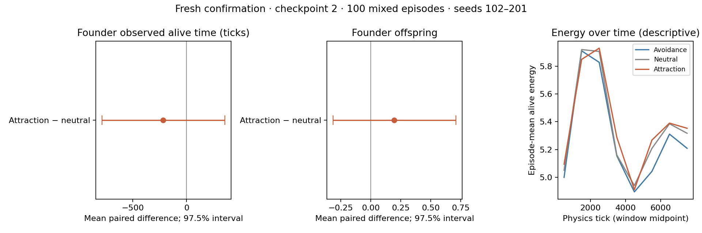

# Fresh-seed confirmation of mixed-preference founder outcomes

## Predeclared design

Run exactly 100 new mixed-population episodes on seeds **102–201**, with
checkpoint `blrep2500_both_learn_s2/checkpoint`, strength 2 and assignment seed
20261027. Six founders give two per preference (-1, 0, +1). Preserve the pilot's
measurement definitions, frozen PPO, rewards and non-heritable preferences.
The pilot's 20 episodes are not pooled into these estimates.

The two primary outcomes are founder observed alive time and offspring per
founder. Each episode contributes the attraction-minus-neutral difference
between its two-founder means. The independent replicate is the episode seed.

Use 10,000 paired episode bootstrap resamples with RNG seed 20261028 and
97.5% marginal percentile intervals for each of the two primary outcomes.
This Bonferroni-style adjustment targets approximate 5% familywise error;
bootstrap coverage is approximate. Joint positive confirmation requires both
lower bounds above zero and no founder censored by an early episode ending.
A failure to confirm does not establish equivalence or absence of an effect.

Keep all seeds, including early episode endings, and report right-censoring
separately from deaths. Founder time is restricted by the observed episode
horizon. If founders are censored before 8,000 ticks, do not interpret their
observed times as complete 8,000-tick restricted survival. Offspring counts
are limited to the observed episode. Born cohorts have unequal follow-up.

Avoidance contrasts, stored energy, reproduction per 1,000 predator-ticks,
and energy in 1,000-tick windows are secondary, descriptive measurements.
Their ordinary 95% bootstrap intervals are not adjusted for multiple comparisons.
No interim outcome analysis, tuning, seed removal or early stopping is planned.
This tests fixed preferences in interacting mixed populations at one checkpoint;
it is not a test of inherited social traits or evolutionary selection.

Four low-priority processes each run 25 consecutive seeds with one Torch
thread. Record the plan, runtime, source/pilot/checkpoint hashes (including all checkpoint metadata files) before any
fresh outcomes. Validate trained modules and weights before and after each
worker and the complete run. A pilot episode (82) must match every saved field,
including fitness. After all 100 episodes finish, a serial fresh-seed replay
(102) must match every field from its parallel run. This is an empirical
fidelity check for those seeds, not a universal equivalence proof.

## Reproduce

From the repository root, choose a new output directory:

```bash
nice -n 10 .conda/bin/python -m predpreygrass.evolutionary.continuous_space.eco_evolutionary_social_preference.fitness_confirmation \
  predpreygrass/evolutionary/continuous_space/eco_evolutionary_social_preference/results/fitness_mixed_checkpoint2_s82_101/fitness.json \
  --output-dir /tmp/ppg_fitness_confirmation_new
```

The runner fixes seeds 102–201 and refuses to overwrite an existing directory.
Detailed episode records remain in four JSONL journals; the final compact
manifest hashes these journals, and the summary contains aggregate estimates.

## Results

**The attraction advantage was not confirmed.** All 100 planned seeds were
included, giving 200 founders of each type. Pilot episodes were not pooled.

| Founder measure | Avoidance −1 | Neutral 0 | Attraction +1 |
|---|---:|---:|---:|
| Mean observed alive time (ticks) | 4172.805 | 4493.755 | 4276.590 |
| Mean observed offspring | 1.840 | 1.855 | 2.050 |
| Founders right-censored at episode end | 38/200 | 41/200 | 40/200 |

| Primary attraction minus neutral contrast | Mean | Adjusted 97.5% interval |
|---|---:|---:|
| Observed alive time (ticks) | -217.165 | [-785.135, 355.787] |
| Observed offspring | 0.195 | [-0.315, 0.710] |

Both intervals include zero. The observed alive-time difference changed sign
relative to the pilot (+1,005 ticks in the pilot, −217 here), and the offspring
difference shrank (+0.925 in the pilot, +0.195 here). The 100-episode result
does not establish benefit, harm or equivalence. It does not support carrying
forward the pilot's apparent survival/reproductive advantage as a finding.

Ninety-nine episodes reached 8,000 ticks. Seed **133** ended at tick **3,257**,
with four founders still alive: one avoidance, one neutral and two attraction.
They remain right-censored, not deaths. This seed was retained as predeclared.
The reported alive-time endpoint therefore describes observed time; it is not
a complete full-horizon restricted survival estimate. The joint confirmation
rule fails both because the intervals include zero and because early-censored
founders remain. The early ending is not the sole reason for the negative
confirmation decision.

Secondary contrasts are also inconclusive. Attraction minus neutral all-animal
reproduction rate was +0.0155 offspring per 1,000 predator-ticks (95% interval
−0.0156 to +0.0467). Mean stored energy differed by +0.0123 (−0.1080 to +0.1360).
Avoidance-versus-neutral intervals likewise include zero for the reported
survival, offspring, energy and reproduction-rate summaries. These secondary
intervals are descriptive and not adjusted for multiplicity.



The first two panels show the predeclared paired primary contrasts and adjusted
intervals. The last panel is descriptive: each point averages episode-level
alive-animal-time energy within a 1,000-tick window. Animals and episodes
without exposure in a window contribute no energy estimate. Changing birth,
survival and episode composition can affect those curves.

The earlier spacing/encounter results remain behavioral findings. This
confirmation provides no reliable evidence that those changes improve observed
survival or reproduction in this fixed mixed population. Preferences were not
inherited, and the experiment supplies no evidence for evolutionary selection
on a social preference gene. No training, reward or environment reproduction
rules were changed.

## Validation, artifacts and independent review

- The saved pilot replay at seed 82 matched every existing field, including
  lifetime records, energy bins and encounter statistics.
- Fresh seed 102 matched every field when replayed serially after the parallel
  run. It is included only once in the 100-seed analysis.
- All four workers validated trained module classes/configurations/tensors and
  independently calculated actor logits before and after evaluation. Workers
  and the parent checked complete checkpoint-file hashes, including constructor
  metadata; source and pilot hashes also remained unchanged.
- An independent final artifact audit confirmed exactly seeds 102–201, 25 rows
  in each journal, matching journal hashes and unchanged source/checkpoint hashes.
- All **46** social-preference tests pass in the project's `.conda` environment.

The independent Codex CLI review prompted explicit assignment-seed pinning,
complete checkpoint-file hashes, worker-level integrity checks, compact output
and additional tests. The correction review found no correctness defect in its
requested scope; my assessment agrees. It noted one coverage gap: the worker's
post-evaluation hash-drift rejection is correct by inspection but lacks a direct
unit test. The earlier review's high-severity output concern was about data
organization, not a numerical defect; detailed episode records were kept in
hashed journals and repeated per-seed vectors removed from the aggregate summary.
See the saved [correction review](results/fitness_confirmation_checkpoint2_s102_201/correction_review.md),
[initial review](results/fitness_confirmation_checkpoint2_s102_201/initial_review.md)
and [second review](results/fitness_confirmation_checkpoint2_s102_201/second_review.md).

The machine-readable [pre-run plan](results/fitness_confirmation_checkpoint2_s102_201/experiment_plan.json)
records the fixed seeds, endpoints, stopping/censoring rules, bootstrap procedure,
runtime and source/checkpoint/pilot hashes. The
[compact manifest](results/fitness_confirmation_checkpoint2_s102_201/fitness.json)
hashes the four detailed `worker_*.episodes.jsonl` journals. Aggregate estimates,
censoring counts and ordinary secondary intervals are in
[summary.json](results/fitness_confirmation_checkpoint2_s102_201/summary.json).
A source snapshot and plotting script are saved alongside these artifacts.
An interrupted development start was preserved in `/tmp` and excluded; outcomes
were not inspected or used to revise the seed list or analysis protocol.
