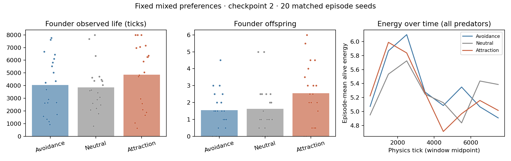

# Survival, offspring and energy under fixed mixed preferences

## Design

Replay the existing mixed-population checkpoint-2 experiment on seeds 82–101,
strength 2, with two founders per preference (-1, 0, +1). Preferences are fixed
for each lifetime, assigned independently of ancestry, and non-heritable.
PPO policies, rewards and the environment's existing reproduction rules are
unchanged. This measures observed survival and reproduction, not evolutionary
selection on a social gene.

The read-only observer samples after every physics tick. Every old episode
field, including encounter spell records and individual assignments, must
match the saved mixed experiment (spell record ordering is canonicalized).
Checkpoint architecture/tensors and checkpoint input hashes are validated
before and after evaluation. Current source hashes and runtime are recorded;
this is empirical agreement on the replayed seeds, not a claim that every
historical dependency/source version is identical.

## Measurements

Primary comparisons use founders: all start at tick zero, with two per type
per episode. Report observed lifespan and observed offspring per founder.
Animals still alive at episode end are right-censored, not counted as deaths.
With a common full 8,000-tick horizon, founder observed lifespan estimates
restricted survival through 8,000 ticks, not eventual lifetime.

Secondary measurements include all predators, separating founders and born
animals in raw data. Birth cohorts have unequal follow-up, so offspring per
1,000 predator-ticks is reported alongside raw counts. This rate can still
reflect age composition and is not an age-adjusted fitness estimate.

Energy is integrated from each alive animal's sample at the start of every
one-tick interval. Its last alive energy contributes to its death interval;
terminal samples and newborns at the final tick have zero subsequent exposure.
The same integrals are partitioned into 1,000-tick windows. Energy reflects
feeding, metabolism, movement and the energy paid for offspring; higher stored
energy alone does not establish greater reproductive success.

The independent unit is an episode seed, not an animal. Each preference's
within-episode mean is paired with the neutral type in the same world.
Exploratory 95% percentile intervals use 10,000 episode bootstrap resamples,
without multiplicity adjustment. These within-mixed-world contrasts do not
estimate what would happen if the whole population changed preference.

## Reproduce

From the repository root:

```bash
.conda/bin/python -m predpreygrass.evolutionary.continuous_space.eco_evolutionary_social_preference.fitness_evaluate \
  predpreygrass/evolutionary/continuous_space/eco_evolutionary_social_preference/results/mixed_checkpoint2_s82_101/mixed_s82_101.json \
  --output-dir /tmp/ppg_fitness_new_run
.conda/bin/python -m predpreygrass.evolutionary.continuous_space.eco_evolutionary_social_preference.fitness_summary \
  /tmp/ppg_fitness_new_run/fitness.json
```

Use a new output directory; the runner refuses to overwrite one.

## Results

All 20 episodes reached 8,000 physics ticks. All previously saved fields
matched for all 20 seeds, and checkpoint validation passed before and after.
There were 40 founders per type across the 20 episodes.

| Founder measure | Avoidance −1 | Neutral 0 | Attraction +1 |
|---|---:|---:|---:|
| Restricted observed lifespan (ticks) | 4046.60 | 3865.97 | 4870.82 |
| Observed offspring per founder | 1.55 | 1.62 | 2.55 |
| Alive at episode end (right-censored) | 6/40 | 9/40 | 13/40 |

| Paired difference from neutral | Avoidance: mean [95% interval] | Attraction: mean [95% interval] |
|---|---:|---:|
| Founder observed lifespan (ticks) | 180.625 [-1352.202, 1629.507] | 1004.850 [-456.561, 2339.608] |
| Founder offspring | -0.075 [-1.050, 0.800] | 0.925 [-0.250, 2.100] |
| All-animal offspring / 1,000 predator-ticks | 0.025 [-0.034, 0.084] | 0.037 [-0.019, 0.095] |
| All-animal mean energy | 0.010 [-0.189, 0.213] | -0.065 [-0.239, 0.120] |

Attraction founders had longer observed lives and more offspring on average,
but both paired intervals include zero. Avoidance contrasts are also
inconclusive. All-animal energy and reproduction-rate intervals include zero.
The energy curves cross over time and do not show a consistent attraction
advantage. These data do not establish a survival or reproductive benefit.



Dots are episode means over two founders of a type; bars average those
20 episode means. Energy curves average each episode's alive-animal-time
energy within each 1,000-tick window; population composition changes over time.
The plot is descriptive; paired uncertainty intervals are in the table above.

The earlier evidence for changed spacing/encounter duration therefore remains
separate from this inconclusive fitness comparison. Only one checkpoint and
20 mixed episodes were used here. Founders have differing inherited physical
traits and share an interacting world; birth-time and survivor composition
also affect all-animal summaries. Preferences themselves were not inherited.
A larger, predeclared fresh-seed replication would be needed before deciding
whether the apparent founder advantage persists. These data should not be
used as a reason to introduce selection or retrain the policy yet.

## Validation and review

All 38 module tests pass in `.conda/bin/python`. Tests cover death and
right-censoring, final-tick births, zero exposure, family-register conservation,
energy intervals and bin boundaries, type partitions, paired summary missing
values, totals and unequal horizons. The real 20-episode replay verifies
agreement of every prior saved field; it does not store every intermediate
position and is not proof of equivalence for untested seeds.

The independent Codex CLI reviewer found no correctness defects in the final
measurement implementation or paired analysis. It recommended a direct summary
test; that test was added and passed. My assessment agrees with the review.
The CLI's Python lacked pytest, so its review compiled and inspected the code;
the passing test suite was run separately in the project's `.conda` environment.
The first review also prompted corrected birth-at-end coverage and narrower
provenance wording. See the saved [final review](results/fitness_mixed_checkpoint2_s82_101/independent_review.md).

Raw records, assignment metadata, 1,000-tick energy bins, replay checks,
checkpoint validation, source hashes and the runtime are in
[fitness.json](results/fitness_mixed_checkpoint2_s82_101/fitness.json).
The pre-run design is in [experiment_plan.json](results/fitness_mixed_checkpoint2_s82_101/experiment_plan.json),
and paired estimates/totals are in [summary.json](results/fitness_mixed_checkpoint2_s82_101/summary.json).
The summary test was added after the experiment; the measurement/runner/summary
sources were unchanged during evaluation. Two interrupted development replays
were excluded; their partial artifacts were moved to `/tmp`.
