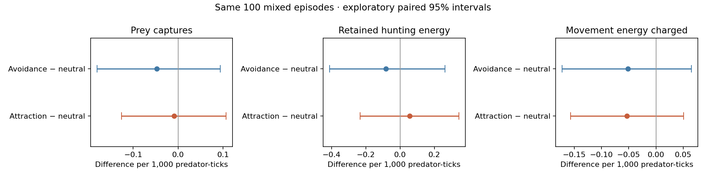

# Hunting captures, feeding energy and movement costs

## Design and definitions

Replay the same mixed-population episodes on seeds **102–201**, checkpoint
`blrep2500_both_learn_s2/checkpoint`, strength 2 and assignment seed 20261027.
Preserve frozen PPO, rewards, physical dynamics, reproduction rules and the
non-heritable preference assignments. Append hunting measurements, then
compare every prior saved episode field (including fitness) with its baseline.
This is a diagnostic extension of the same trajectories, not fresh replication.

The observer wraps the existing environment instance's `_energy` and `_gain`
methods, calling each original exactly once and preserving arguments, return
values and animal ordering. The environment source is unchanged. Measurements
use the existing catch list and actual post-movement velocity, not inferred
captures or moving-action frequency.

- **Captures:** credit each caught prey to its original catcher in the existing
  simulation. This measures individual capture credit, not cooperative effort,
  attack attempts, prey encounters or all participants in a group capture.
- **Offered hunting energy:** catch efficiency times prey energy at capture,
  when the original rule allows the predator to feed.
- **Retained hunting energy:** actual before/after change in the predator's
  energy for each original `_gain` call. Feeding at the energy cap may retain
  less than the offered amount. Their difference is storage-cap loss.
- **Movement energy charged:** the existing predator speed-cost coefficient
  times its velocity magnitude after movement, once per physics tick.
- **Resting energy charged:** the resting-cost coefficient times the animal's
  physical-trait cost multiplier. Reproductive expenditure is tracked separately.

The observer checks each individual's predator-tick exposure against its
fitness record, then checks conservation: final minus initial energy equals
retained hunting energy minus movement, resting and offspring energy costs.
Death-interval costs and negative terminal energy are included, following the
existing environment. A final-tick newborn has zero subsequent exposure.

Compare rates per **1,000 observed predator-ticks** by preference type. All
animals are the main descriptive cohort; founder-only rates and offered energy,
resting cost, net feeding-minus-metabolism and feeding/metabolic-cost ratios
are secondary diagnostics. Rates in the comparison table average episode-level
rates, not pooled animal-time ratios. Raw exposure and energy totals are also
saved. Age, physical-trait and survivor composition may affect these comparisons.

Use 10,000 paired episode bootstrap resamples (seed 20261026) for descriptive
95% intervals. The episode seed is the replicate, not an animal or a catch.
Intervals are exploratory and not adjusted for multiple comparisons. Retain
all 100 seeds, including the early ending at seed 133; do not impute hunting
after episode end. Do not tune or analyse interim outcomes.

Four low-priority workers run the same 25-seed chunks as the baseline. Each
completed episode must match every prior saved field before its new record
is written. After the 100 replays, seed 102 is replayed serially and must also
match the new hunting ledger. Modules, checkpoint metadata, source, runtime
and baseline hashes are checked. Use a new output directory; no experiment
is overwritten.

## Reproduce

From the repository root:

```bash
nice -n 10 .conda/bin/python -m predpreygrass.evolutionary.continuous_space.eco_evolutionary_social_preference.hunting_replay \
  predpreygrass/evolutionary/continuous_space/eco_evolutionary_social_preference/results/fitness_confirmation_checkpoint2_s102_201 \
  --output-dir /tmp/ppg_hunting_new_run
```

## Results

**No clear hunting advantage or extra movement cost was detected for attraction.**
All 100 episodes matched every prior saved field. The new serial-versus-parallel
seed-102 replay also matched, including hunting records. The early ending at
seed 133 remained at tick 3,257; the other 99 episodes reached 8,000 ticks.

The following are episode-mean rates for all predators, per 1,000 observed
predator-ticks:

| Measure | Avoidance −1 | Neutral 0 | Attraction +1 |
|---|---:|---:|---:|
| Prey captured | 3.7334 | 3.7808 | 3.7718 |
| Retained hunting energy | 8.7235 | 8.8063 | 8.8630 |
| Movement energy charged | 3.3444 | 3.3961 | 3.3425 |
| Resting energy charged | 4.9988 | 5.0080 | 5.0108 |
| Feeding minus movement/rest costs | 0.3803 | 0.4022 | 0.5097 |

| Attraction minus neutral | Mean difference | Exploratory 95% interval |
|---|---:|---:|
| Prey captured | -0.0090 | [-0.1256, +0.1070] |
| Retained hunting energy | +0.0567 | [-0.2328, +0.3430] |
| Movement energy charged | -0.0536 | [-0.1569, +0.0506] |
| Resting energy charged | +0.0028 | [-0.0160, +0.0220] |
| Feeding minus movement/rest costs | +0.1075 | [-0.1167, +0.3396] |

All main intervals include zero, as do the founder-only and avoidance contrasts.
Attraction's capture rate was approximately 0.24% below neutral, retained feeding
energy 0.64% above, and movement energy 1.58% below; these small point differences
are inconclusive. The feeding/metabolic-cost ratio difference was +0.0147
(95% interval −0.0126 to +0.0433), also inconclusive.

Offered and retained hunting energy differed only by floating-point rounding
(maximum individual difference about 5.7e−14); storage caps did not materially
limit feeding in these episodes. The cap-aware measurement remains necessary
for other settings, and its clipped-feeding behavior is unit-tested.



These measurements do not show closer spacing translating into a detectable
capture or feeding return. They also do not support the specific explanation
that attraction raises movement costs enough to cancel a hunting advantage:
movement costs were not clearly higher. The lack of a reliable survival or
offspring advantage remains consistent with the absence of a clear hunting
advantage, but this does not identify a causal mechanism or prove equivalence.

All-animal rates reflect age, physical traits, location, prey opportunities
and survivor composition. Founder-only rates have wider intervals and do not
resolve those mechanisms. Capture credit follows the existing first-catcher
rule; it cannot establish cooperation, coordination or contributions by other
predators. The same trajectories were reused for these exploratory diagnostics,
so this is not an independent confirmation of any newly selected effect.

Raw totals illustrate why exposure normalization matters: avoidance, neutral
and attraction received 13,825, 14,378 and 14,518 captures respectively, but
had 3,711,361, 3,790,380 and 3,839,111 predator-ticks of exposure. Raw catch
counts alone would obscure these differences. The main estimates average
within-episode rates; they are not pooled ratios of those totals.

## Verification and independent review

Every completed episode had to match all old fields before its hunting record
was accepted. A separate artifact audit verified exactly seeds 102–201, all
four 25-row journal hashes, checkpoint/source/baseline hashes and trained-module
validation. Serial seed 102 matched the full parallel result.

There are **4,297 individual predator ledgers**, including founders and births.
Every ledger's exposure matches its fitness record, and its energy balances
with maximum absolute residual **9.4e−12**. Reproduction costs are included
in this check even though the main comparison separates them from metabolism.

All **51 current module tests** pass, using only the module's top-level tests:

```bash
.conda/bin/python -m pytest -q predpreygrass/evolutionary/continuous_space/eco_evolutionary_social_preference/test_*.py
```

This explicit test selection avoids counting archived source-snapshot tests as
additional current tests. New tests cover the original environment energy code,
multiple capped catches, death intervals, final-tick births, reproduction costs,
repeat resets, ledger corruption, prior-field replay rejection, paired rate
summaries and raw totals.

The independent Codex CLI review found no correctness bugs in the read-only
hooks, capture/clipping semantics, metabolic costs, conservation checks,
100-seed replay, multiprocessing or paired summaries. My assessment agrees;
there were no conflicting numerical findings. See the saved
[independent review](results/hunting_checkpoint2_s102_201/independent_review.md).
No policy, reward, environment source or social inheritance changes were made.

## Artifacts

The [pre-run plan](results/hunting_checkpoint2_s102_201/experiment_plan.json)
records definitions, fixed seeds, runtime and input/source hashes. The compact
[hunting manifest](results/hunting_checkpoint2_s102_201/hunting.json) hashes
four `worker_*.episodes.jsonl` journals containing old measurements and new
individual hunting ledgers. The
[summary](results/hunting_checkpoint2_s102_201/summary.json) contains rates,
paired intervals, cohort totals and balance residuals. The source ZIP archive,
plotting script and design snapshot are saved alongside these artifacts.
