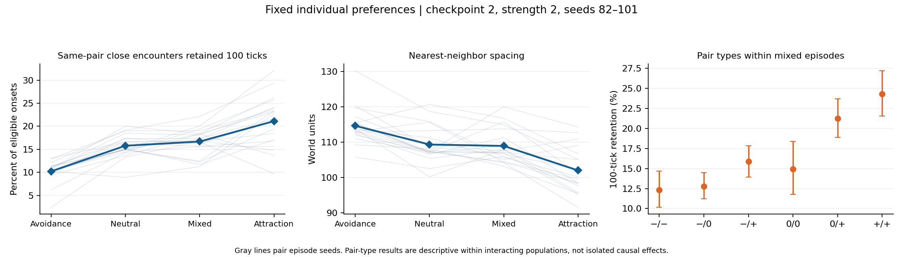

# Fixed individual social preferences

Completed 2026-10-27. Predators can now have different lifetime-fixed social
preferences without inheritance. In a balanced mixed population, attraction–
attraction pairs have longer encounters than avoidance–avoidance pairs, but
the overall population does not show a clear proximity improvement over neutral.

## Implementation and assignment

`individual_preferences.py` stores external preferences separately from the
three body genes and PPO observations. Each predator receives -1, 0 or +1.
A SHA-256 key of assignment seed (20261027), episode seed and consecutive
predator-ID block selects a permutation of these values for each block of
three IDs. The six founders therefore have two of each preference. This
randomizes preference across IDs, with dependence within blocks to enforce
balance; it is not independent Bernoulli sampling for every birth.

A newborn's value comes from its own ID and the fixed assignment rule,
without reading parental preferences or ancestry. It remains unchanged for
that animal's lifetime. No simulation RNG draws are consumed by assignment.
Founders, births, deaths and final counts are auditable in episode output.
Balance across consecutive IDs does not imply equal counts among survivors.
This is an externally assigned behavioral trait, not a genetic proximity gene.

`evaluate.py` accepts an optional per-agent assignment object. Scalar behavior
remains available. Newborns are registered after the original physics step,
before the read-only observer and their next action. Only predator action
logits are biased; prey policies, rewards, PPO, body-gene inheritance and
physics remain unchanged. There is no recognition of another animal's
preference: the directional target is still the nearest visible conspecific.

`preference_metrics.py` partitions 100-unit proximity spells and tick exposures
by unordered pair type and focal preference. It uses the same censoring and
100-tick retention definitions as the existing persistence observer. Group
exposures sum to the global exposures, with potential-pair-time denominators.

## Matched experiment and complete control verification

The second frozen checkpoint, `blrep2500_both_learn_s2/checkpoint`, was tested
with seeds 82–101 and strength 2:

- New runs: 20 uniform-avoidance episodes and 20 balanced mixed episodes.
- Controls: the saved 20 neutral and 20 uniform-attraction episodes, each
  replayed through the new per-agent path and checked against every saved field.
- All 40 control replays matched exactly. Only arbitrary iteration order in
  compact spell-record lists was canonicalized; durations, censoring flags,
  fields and other ordered lists were not discarded or rounded.
- Saved weights, constructor settings, founder-pool hashes and independent
  actor logits passed before/after validation. Source/input files remained
  fixed during both the new runs and the separate control verification.
- Every assignment was recomputed and audited against its ID-based rule.
  Every mixed episode had two founders of each type. Existing results were
  preserved; the combined analysis reads immutable original controls.
- All 34 final local tests pass. Tests cover seed/order invariance, balance,
  fixed values across registration, no NumPy RNG use, newborn registration in
  the evaluator, neutral action equality and category-exposure partitioning.

## Population-level results

Equal-weight averages of 20 episode estimates. Differences use exploratory
95% paired percentile bootstrap intervals, 10,000 resamples of episode seeds,
without adjustment for multiple metrics or pair types.

| Measurement | Uniform avoidance | Neutral | Mixed | Uniform attraction |
|---|---:|---:|---:|---:|
| Close encounters retained for 100 ticks | 10.22% | 15.78% | 16.68% | 21.11% |
| Nearest-neighbor spacing (world units) | 114.65 | 109.35 | 108.95 | 102.01 |
| Mean completed encounter duration (ticks) | 43.64 | 56.32 | 58.11 | 69.84 |
| Predator-time with a close neighbor | 40.51% | 47.06% | 47.29% | 54.97% |
| Mean population, time weighted | 13.80 | 13.97 | 13.95 | 13.87 |

Mixed minus neutral:

- 100-tick encounter retention: **+0.90 percentage points [-0.23, +2.02]**.
- Nearest-neighbor distance: **-0.40 world units [-2.90, +2.26]**.
- Completed encounter duration: +1.78 ticks [-1.41, +4.87].

These intervals include zero; the experiment does not establish an overall
proximity improvement for the mixed population. It is not an equivalence
test or proof that the populations behave identically.

Mixed populations have shorter retention than uniform attraction (-4.42
percentage points [-6.47, -2.23]) and wider spacing (+6.94 units [4.67, 9.10]).
They have longer retention than uniform avoidance (+6.47 points [5.01, 7.94])
and closer spacing (-5.71 units [-8.14, -3.17]).

Every mixed episode reached 8000 ticks, as did the neutral and attraction
controls. Uniform avoidance ended early on seeds 88 and 97. Excluding both
seeds from every condition leaves 18 matched pairs and keeps the mixed-versus-
neutral retention difference inconclusive. This is an outcome-selected
sensitivity check, not a reason to discard early outcomes.

## Local pattern within mixed populations

The same-pair 100-tick retention estimates below exclude initial and
birth-onset encounters and handle deaths/episode endings as censoring.
Intervals resample episode means, not individual encounters.

| Pair preferences | Mean retention | 95% bootstrap interval |
|---|---:|---:|
| Avoidance / avoidance | 12.31% | [10.16, 14.68]% |
| Avoidance / neutral | 12.77% | [11.25, 14.49]% |
| Avoidance / attraction | 15.90% | [13.94, 17.82]% |
| Neutral / neutral | 14.94% | [11.75, 18.41]% |
| Neutral / attraction | 21.24% | [18.90, 23.69]% |
| Attraction / attraction | 24.30% | [21.56, 27.20]% |

The within-episode attraction/attraction minus avoidance/avoidance difference
is +11.98 percentage points [8.23, 15.85]. This is a descriptive contrast among
interacting animals. Encounter selection, age, body traits, location and
survival differ among groups; it is not an isolated causal effect or proof
of partner recognition, preference-based assortment or fitness advantage.

The overall result is compatible with attraction and avoidance partly
counterbalancing. It does not establish that this is the only mechanism.
Time-weighted mean living counts were 4.85 avoidance, 4.34 neutral and 4.76
attraction. These counts do not measure reproductive fitness or inherited
selection: social values are assigned afresh by ID, not transmitted.

## Independent review and source history

The first independent Codex review found no logic defects in fixed assignment,
per-agent logits, RNG isolation or category exposure/spell partitioning. It
noted missing CLI access and evaluator-level coverage. A dedicated
`mixed_evaluate` CLI and evaluator/newborn tests address those points.

The runner review then raised a source-compatibility concern about reusing
controls after evaluator changes. All 40 saved uniform episodes were therefore
replayed through the new per-agent path and compared in full. The current
runner requires this complete replay before new experiments, rather than
accepting just the initial two smoke episodes.

The recorded experiment started with the earlier runner, whose exact source
is archived in `mixed_evaluate_recorded_source.py`. Its full control replay
was performed separately by `uniform_verification_driver.py`, which invokes
`evaluate` for all 20 seeds per condition and imports only `canonical` from
the original runner. Importing a module does not execute its guarded `main()`.
`uniform_verification.json`, its 40-row journal and a provenance sidecar record
that separate verification. Driver source was archived after completion; the
original results and verification files were not rewritten.

The focused re-review accepted the current full-replay gate, but questioned
how the earlier runner could have produced the 40-episode proof. I agree the
original archive alone was insufficient to explain the entrypoint; it did
not produce that proof. The separate verification driver and its supplementary
provenance record make this distinction explicit. Dependency hashes include
the imported runner, rather than identifying it as the executed entrypoint.
I do not interpret this history issue as a numerical mismatch: the actual
replay completed, its comparisons passed, and all source-content hashes match
between recorded experiments and verification after normalizing path spelling.

Known broader review follow-ups remain in REVIEW.md. There is no claim here
that one mixed composition and one trained checkpoint establish robust
heritable social behavior. The six-founder design, ID-block dependence,
existing body-trait evolution and encounter censoring remain limitations.

## Artifacts and next decision

- [Experiment plan](results/mixed_checkpoint2_s82_101/experiment_plan.json)
- [Mixed raw episodes and preference assignments](results/mixed_checkpoint2_s82_101/mixed_s82_101.json)
- [Uniform avoidance episodes](results/mixed_checkpoint2_s82_101/avoidance_s82_101.json)
- [All 40 control verification results](results/mixed_checkpoint2_s82_101/uniform_verification.json)
- [Separate verification driver/provenance](results/mixed_checkpoint2_s82_101/uniform_verification_provenance.json)
- [Paired summaries and pair-type results](results/mixed_checkpoint2_s82_101/summary.json)
- [Full-horizon sensitivity check](results/mixed_checkpoint2_s82_101/full_horizon_sensitivity.json)

The per-individual mechanism now works in a heterogeneous population and
produces different local encounter patterns, but a balanced mixture does
not reproduce the population-wide attraction effect. Before introducing
inheritance, the useful next question is whether preference types differ in
survival and offspring production, or how changing the mixture changes the
population response. No social gene, mutation or inheritance was introduced.
