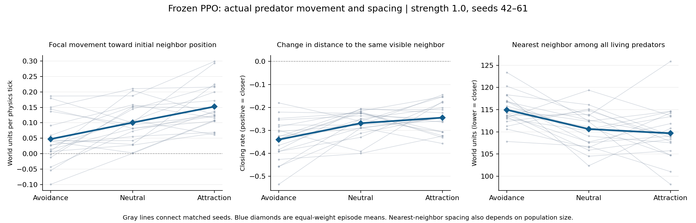

# Actual movement: matched-seed evaluation

Completed 2026-10-26. Attraction changes actual predator movement, but this
experiment does not establish that it creates tighter or lasting groups.

## Setup and validation

- Frozen checkpoint: `eco_evolutionary_continuous_traits/runs/blrep2500_both_learn_s1/checkpoint`.
- Conditions: avoidance -1, neutral 0, attraction +1; strength 1.0.
- Seeds 42–61: 20 episodes per condition, 60 episodes total. Seeds 42–44 repeat the pilot.
- Runtime: project `.conda/bin/python`, Ray 2.59.0, PyTorch 2.14.1+cu132; one CPU thread, nice priority 10.
- Sixteen tests passed. Seed-42 smoke testing reproduced every prior metric exactly.
- All prior metrics for seeds 42–44 also matched the earlier pilot in all conditions.
- Every neutral action and Torch RNG state matched the original evaluator throughout all 20 neutral episodes.
- Both species' saved constructors, architecture settings, and all 14 tensors matched exactly before and after the run. Independent actor-logit error remained zero.
- Existing background jobs (`both_learn 3` and `pred_frozen 3`) were left running. Their seed-3 outputs differ from the seed-1 checkpoint used here.
- PPO, rewards, physics, trait expression, and inheritance were unchanged. Hidden state was used only to measure behavior.

## Condition means

Each entry averages 20 episode means with equal episode weight. Measurements
of actual movement use living predators, shortest toroidal offsets, and a
neighbor fixed at the beginning of each decision interval. Nearest-neighbor
distance includes all living conspecifics, regardless of visibility. The
world-unit nearest-neighbor values below equal the raw normalized values
multiplied by 400.

| Metric | Avoidance | Neutral | Attraction |
|---|---:|---:|---:|
| Movement toward initial visible-neighbor position (world units/tick) | 0.0473 | 0.1006 | 0.1523 |
| Actual displacement alignment when moving (cosine) | 0.0009 | 0.0443 | 0.0848 |
| Same-pair closing rate (world units/tick; positive = closer) | -0.3405 | -0.2691 | -0.2449 |
| All-predator nearest-neighbor distance (world units) | 114.9542 | 110.6174 | 109.6729 |
| Mean predator population per decision | 13.1937 | 13.5649 | 13.1046 |

## Paired differences from neutral

Intervals are exploratory 95% percentile bootstrap intervals from 10,000
resamples of matched episode seeds. Decisions and agents are not treated as
independent replicates; intervals are not adjusted for multiple comparisons.

| Metric | Avoidance minus neutral [95% interval] | Attraction minus neutral [95% interval] |
|---|---:|---:|
| Movement toward initial visible-neighbor position (world units/tick) | -0.0533 [-0.0876, -0.0197] | +0.0517 [+0.0216, +0.0831] |
| Actual displacement alignment when moving (cosine) | -0.0434 [-0.0632, -0.0239] | +0.0406 [+0.0265, +0.0552] |
| Same-pair closing rate (world units/tick; positive = closer) | -0.0714 [-0.1089, -0.0347] | +0.0242 [-0.0122, +0.0625] |
| All-predator nearest-neighbor distance (world units) | +4.3368 [+2.1254, +6.5705] | -0.9444 [-3.8066, +1.9393] |
| Mean predator population per decision | -0.3712 [-0.8054, +0.0541] | -0.4603 [-0.9949, +0.0590] |

## Interpretation

Attraction increased focal movement toward the neighbor's initial position
by 0.0517 world units per physics tick compared with neutral (interval
0.0216 to 0.0831). The difference was positive on 16 of 20 seeds. Actual
movement alignment also increased, on 18 of 20 seeds. Avoidance shifted
both measures in the opposite direction.

This is a physical movement effect, beyond the previously demonstrated
change in action logits. Net displacement can differ from selected action
direction because of inertia, collisions, and action repetition.

The attraction condition's change in pair-closing rate and nearest-neighbor
spacing remains uncertain: both intervals include zero. All three conditions
have negative mean pair-closing rates over intervals that start with a
visible neighbor, meaning those pairs separate on average. Attraction
reduces the point estimate of that separation, but the paired evidence is
not decisive. Focal movement toward a neighbor's previous position does not
ensure the pair gets closer, because the neighbor moves too.

Avoidance increased nearest-neighbor spacing by about 4.34 world units
(interval 2.13 to 6.57). This is more consistent than the attraction spacing
effect, but spacing can also respond to population density and reproduction.
Population differences themselves have intervals spanning zero. None of
these measurements demonstrates stable social groups or improved fitness.

## Sensitivity and limits

Using only the 17 new seeds (45–61) keeps the attraction projection effect
positive: +0.0415 [0.0104, 0.0728]. Attraction's pair-closing and spacing
intervals still include zero. These are exploratory checks, not a new
independent confirmatory experiment.

One neutral episode (seed 42) and one attraction episode (seed 43) ended
before the 8000-tick horizon; all avoidance episodes reached it. Excluding
both seeds from all conditions gives 18 matched pairs and preserves the same
qualitative conclusions. This exclusion is a descriptive sensitivity check
selected using outcomes, not a correction that removes survivor bias.

Focal deaths exclude displacement measurements; either member's death
excludes pair-closing measurements. Counts are saved in the raw results.
Rates are averaged over agent-decision intervals, not weighted by elapsed
ticks; births can shorten an interval. Nearest-neighbor distance is weighted
by living agent-decisions within an episode. These measures cannot establish
persistent group membership, and results concern one PPO training checkpoint
at one preference strength. Matched seeds align starting conditions; later
trajectories, populations and random draws diverge.

The independent Codex CLI review completed after repairing the default model
configuration. See [REVIEW.md](REVIEW.md) for findings and the primary-agent
assessment. Confirmed follow-ups concern counterfactual probability precision
and checks under optimized Python; those code changes remain open. The reviewer
agreed with the physical metric definitions and strong checkpoint fidelity checks.

## Files and next decision

- [Complete raw results and paired summaries](results/movement_s42_61_strength1.json)
- [Per-episode progress records](results/movement_s42_61_strength1.episodes.jsonl)
- [Smoke run](results/movement_smoke_s42.json)
- [Measurement definitions and command](README.md#actual-movement-evaluation)

The next useful experiment is a small strength sweep with the same frozen
checkpoint and these physical measurements, paired with a few visual trajectory
checks. The question is whether stronger attraction yields pair closing and
closer spacing. This result does not yet justify adding social inheritance.
