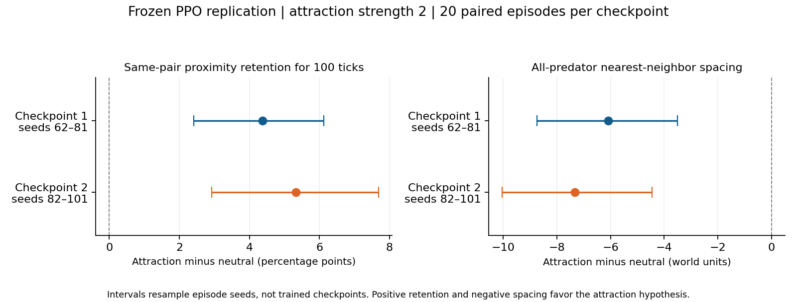

# Replication on a second frozen checkpoint

Completed 2026-10-27. The strength-2 attraction effect replicates on a second
trained checkpoint: close encounters last longer and predators have closer
average spacing. Persistent choice of the same nearest neighbor remains
inconclusive. This is not yet evidence of stable social groups or fitness gains.

## Predeclared comparison

- Checkpoint: `eco_evolutionary_continuous_traits/runs/blrep2500_both_learn_s2/checkpoint`.
- Neutral versus fixed preference +1 at strength 2; PPO remains frozen.
- Twenty fresh matched episode seeds, 82–101; 40 episodes total. No overlap with the first checkpoint's 62–81 persistence seeds.
- Primary close distance 100 world units and continuous same-pair retention horizon 100 physics ticks. Sensitivity distances 75 and 125 were unchanged.
- Existing reviewed persistence evaluator and analysis were reused without code changes. An experiment plan was saved before evaluation.
- The saved environment configuration is identical across training runs. Predator and prey actor parameters both differ (maximum absolute differences 4.0400 and 2.8173 respectively).
- Each checkpoint uses its own saved founder gene pool, matched between neutral and attraction within that checkpoint. Thus this tests a second trained ecosystem state, not a policy-only intervention with a common founder pool.
- No rewards, training, physics or inheritance mechanisms were changed. Existing background jobs were left running; inference used one CPU thread at low priority.

## Validation

All 27 existing tests pass. Both species passed saved-tensor, constructor,
configuration and independent actor-logit checks before and after evaluation.
Every neutral action and RNG-state comparison passed. All 40 episodes reached
8000 physics ticks, and weights, settings, founder pool and source hashes stayed
unchanged. Both conditions have identical provenance and intended preferences
0 and +1 at strength 2. There is exactly one result input per condition.

The measurement source hashes and runtime versions also match the first
checkpoint's persistence experiment. Saved-state SHA-256 values differ for
both species across checkpoints. The plan, raw validation results, paired
summaries and input hashes are in the artifacts below.

## Second-checkpoint results

Equal-weight means of 20 episode estimates. Intervals are exploratory 95%
paired percentile bootstrap intervals from 10,000 resamples of episode seeds;
there is no adjustment for multiple metrics. Decisions and individual animals
are not treated as independent replicates.

| Measurement | Neutral | Attraction 2 | Paired difference [95% interval] |
|---|---:|---:|---:|
| Nonbirth close encounters retained for 100 ticks, distance 100 | 15.78% | 21.11% | +5.33 percentage points [2.93, 7.69] |
| Mean completed close-encounter duration | 56.32 ticks | 69.84 ticks | +13.52 ticks [7.50, 19.52] |
| Predator-time with any neighbor within 100 units | 47.06% | 54.97% | +7.91 percentage points [5.07, 10.55] |
| All-predator nearest-neighbor distance, agent-time weighted | 109.35 units | 102.01 units | -7.34 units [-10.03, -4.45] |
| Same nearest-neighbor identity retained for 100 ticks | 16.69% | 17.04% | +0.35 percentage points [-1.16, 1.76] |
| Mean predator population, time weighted | 13.97 | 13.87 | -0.10 [-0.66, 0.50] |

Average spacing is about **6.7% closer than neutral**. The population
comparison is inconclusive, whereas both primary outcomes have intervals
excluding zero in the expected direction.

The close-pair retention change also has intervals above zero at the
75-unit and 125-unit thresholds: +4.40 percentage points [2.28, 6.52], and
+2.79 points [0.25, 5.37], respectively.

## Across-checkpoint assessment

| Primary effect, attraction minus neutral | Checkpoint 1, seeds 62–81 | Checkpoint 2, seeds 82–101 |
|---|---:|---:|
| Same-pair 100-tick retention | +4.38 pp [2.42, 6.12] | +5.33 pp [2.93, 7.69] |
| Nearest-neighbor distance | -6.09 units [-8.74, -3.51] | -7.34 units [-10.03, -4.45] |

Both trained states support longer local encounters and closer average
spacing. The point estimates differ, but this analysis does not establish
that one checkpoint has a stronger effect than the other. There are only
two trained checkpoints, their continuation runs share an initial training
checkpoint, their founder pools differ, and different evaluation seed sets
were used. Intervals quantify episode variation within each checkpoint;
they are not uncertainty intervals across trained policies. Results must
not be pooled as 40 independent trained-policy replicates.

## Censoring and remaining limits

As before, initial spells are left-censored and birth-onset encounters are
excluded from the primary analysis. Death and episode termination censor
short encounters rather than silently counting them as spatial separation.
Completed-duration means exclude censored encounters and are descriptive.
The primary known-outcome retention estimate is accompanied by bounds:
15.40–17.79% for neutral and 20.48–23.45% for attraction if unresolved spells
are treated as all failures versus all successes. These ranges are censoring
bounds, not confidence intervals.

Keeping one particular nearest neighbor is inconclusive in both checkpoints.
Closer encounters may involve relatives or repeated short associations;
birth filtering does not remove every parent/offspring encounter. This
experiment does not establish stable group membership, cooperation,
coordinated hunting, improved fitness, or evolutionary selection for a
social trait. Preference is still externally assigned, not inherited.

The pre-existing review follow-ups about generic trace-to-run binding,
treatment-input checks, ambiguous input directories, counterfactual precision
and optimized-Python assertions remain documented in REVIEW.md. For this
known experiment, treatment fields and unique inputs were explicitly verified;
standard Python was used. Position traces for preselected seeds 82 and 83
are saved, but new videos were not needed for this checkpoint-replication
question. Numerical results use every physics tick, not sparse trace frames.

## Artifacts and next decision

- [Experiment plan](results/checkpoint2_persistence_s82_101/experiment_plan.json)
- [Neutral raw results and validation](results/checkpoint2_persistence_s82_101/neutral_s82_101.json)
- [Attraction raw results and validation](results/checkpoint2_persistence_s82_101/attraction2_s82_101.json)
- [Full paired summary](results/checkpoint2_persistence_s82_101/summary.json)
- [Across-checkpoint comparison and hashes](results/checkpoint2_persistence_s82_101/checkpoint_comparison.json)
- [First checkpoint persistence report](PERSISTENCE_RESULTS.md)

The evidence now supports a repeatable social-attraction mechanism across
these two trained states. A reasonable next implementation experiment is
individual, fixed predator preferences to test heterogeneous populations;
inheritance and mutation should be a separate, explicitly authorized step.
No proximity gene was added in this experiment.
