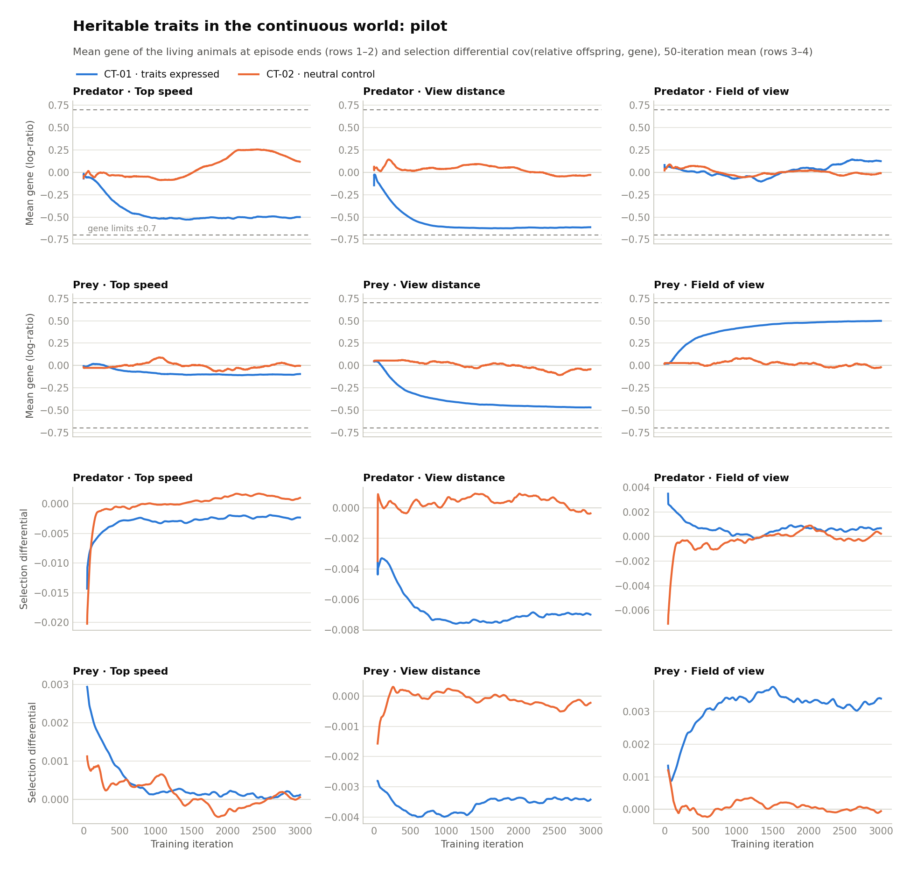
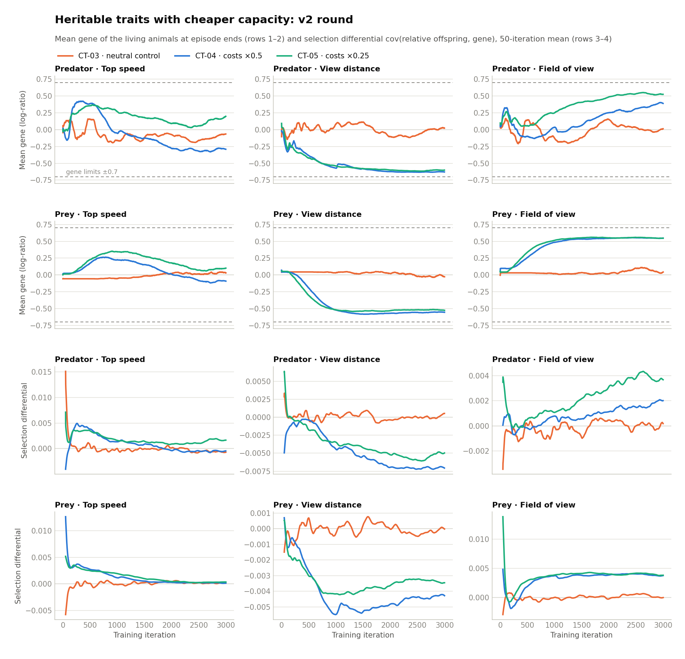
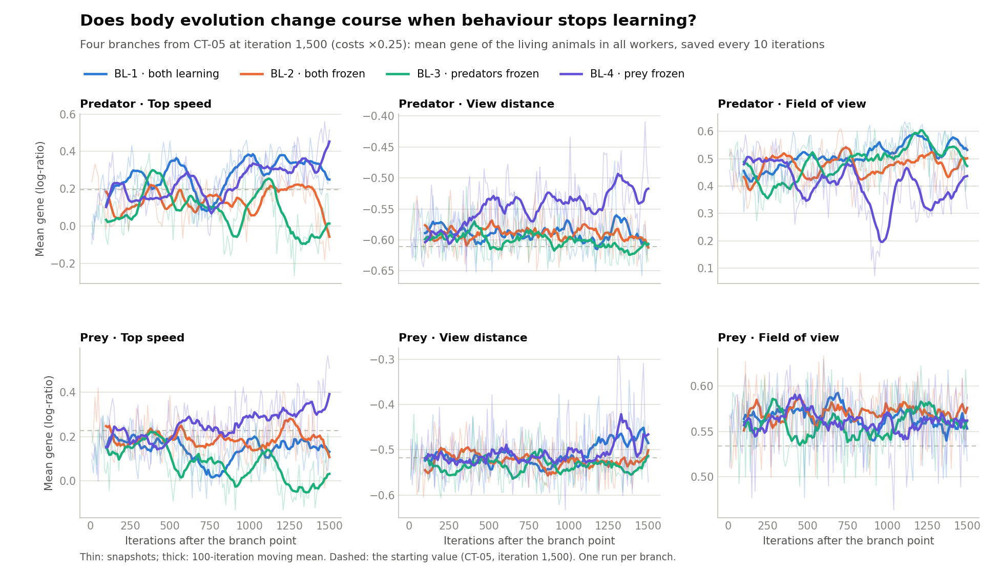

# eco_evolutionary_continuous_traits: results

## Runs

| Run | Folder (`runs/eco_evolutionary_continuous_traits_...`) | Traits | Iterations | Simulation workers | Wall time | Status |
|---|---|---|---:|---:|---:|---|
| CT-01 | `2026-10-15_21-31-22_924979` | expressed | 3,000 | 14 | 21.3 h | completed |
| CT-02 | `2026-10-15_21-31-42_894279` | neutral control | 3,000 | 14 | 13.8 h | completed |
| CT-03 | `2026-10-16_20-52-50_092027` | neutral control, fixed observation scales | 3,000 | 10 | 15.6 h | completed |
| CT-04 | `2026-10-16_20-53-10_085977` | expressed, costs 0.5× the pilot's, fixed observation scales | 3,000 | 10 | 24.7 h | completed |
| CT-05 | `2026-10-16_20-53-30_161103` | expressed, costs 0.25× the pilot's, fixed observation scales | 3,000 | 10 | 23.7 h | completed |
| BL-1 | `2026-10-18_06-18-25_230954` | CT-05 from iteration 1,500, both species learning | 1,500 | 7 | 12.0 h | completed |
| BL-2 | `bl2_frozen_both` (`evolve_frozen.py`) | CT-05 from iteration 1,500, both policies frozen | 1,500 (equivalent steps) | 7 islands | 2.6 h | completed |
| BL-3 | `2026-10-18_06-18-45_270476` | CT-05 from iteration 1,500, predators frozen | 1,500 | 7 | 10.3 h | completed |
| BL-4 | `2026-10-18_06-19-05_426648` | CT-05 from iteration 1,500, prey frozen | 1,500 | 7 | 6.7 h | completed |
| BR (15 runs) | `blrep_<arm>_s<seed>` | replication of BL-1 to BL-4 (section 5): 3 seeds each of both learning, predators frozen, prey frozen (RLlib, seeded), both frozen and neutral frozen (`evolve_frozen.py`) | 1,500 | 7 | 6.0–15.4 h (RLlib), 1.0–2.8 h (frozen) | completed |

CT-01 and CT-02: every quirk fixed, cost coefficients speed 1.0, vision
0.5, field of view 0.25 (SPEC.md section 11), trained side by side from
scratch. CT-03 to CT-05: the same, but with `observation_fixed_scale`
(commit d3ffee3) and 10 simulation workers each, trained side by side. A first
attempt at the pair (2026-10-15, 20:00) was stopped after about 200
iterations to speed up the contact search (commit af36d91); its logs are
kept as `runs/train_ct0*_2026-10-15_20-*.aborted.log`.

## 1. Pilot: traits expressed against the neutral control (CT-01, CT-02)

**Question.** Do the traits evolve by selection rather than drift, and does
an arms race in bodies appear next to the learning arms race?

**Measures.** Mean gene of the living animals at the end of every episode,
and the selection differential `cov(offspring / mean offspring, gene)` over
every animal of the episode (SPEC.md section 11), both averaged by RLlib
over recent episodes and logged per iteration; a 50-episode final check
and a tournament of checkpoints 300–2,990 (every 300, 100 episodes per
matchup, seeds 10,000–10,099), each species playing with the gene pool of
its own checkpoint. [`analysis/pilot.py`](analysis/pilot.py) writes
[`analysis/results/pilot.json`](analysis/results/pilot.json) and the figure.

**Genes and selection** (mean gene at the end of training; selection
differential averaged over all iterations, and the share of iterations in
which it is positive):

| | CT-01 mean gene | CT-01 selection (share > 0) | CT-02 mean gene | CT-02 selection (share > 0) |
|---|---:|---:|---:|---:|
| Predator speed | −0.50 | −0.0031 (0%) | +0.12 | −0.0001 (59%) |
| Predator vision | −0.61 | −0.0067 (0%) | −0.03 | +0.0003 (81%) |
| Predator field of view | +0.12 | +0.0007 (95%) | −0.01 | −0.0003 (38%) |
| Prey speed | −0.10 | +0.0004 (100%) | 0.00 | +0.0001 (61%) |
| Prey vision | −0.47 | −0.0036 (0%) | −0.04 | −0.0001 (35%) |
| Prey field of view | +0.50 | +0.0031 (100%) | −0.02 | +0.0001 (66%) |

Genes are log-ratios to the species' base value, limited to ±0.7: CT-01's
predators end at about 0.61 × the base top speed and 0.54 × the base view
distance, its prey at 0.63 × the base view distance and 1.65 × the base
field of view.

**Final checks** (50 episodes each; BE-04 and BE-05 of
`base_environment_continuous`, the same world without traits, for
comparison):

| Run | Coexisting | Prey extinct | Predators extinct | Catch risk | Predators / prey alive on average | Predators stopped | Prey stopped | Catches by a standing predator |
|---|---:|---:|---:|---:|---:|---:|---:|---:|
| CT-01 | 13 | 36 | 1 | 1.18 | 19.5 / 44.4 | 65% | 67% | 10% |
| CT-02 | 46 | 1 | 3 | 1.53 | 10.0 / 32.0 | 46% | 7% | 2.5% |
| BE-04 | 47 | 1 | 2 | 1.93 | 10.6 / 27.1 | 44% | 7% | 2% |
| BE-05 | 46 | 1 | 3 | 1.69 | 10.4 / 28.8 | 48% | 3% | 2% |

**Tournaments** (share of comparisons against a fixed opponent in which
the newer checkpoint does better, and mean catch-risk change late in
training; 95% paired-seed bootstrap intervals):

| Run | Prey, all | Predators, all | Prey risk reduction, late | Predator risk increase, late | Episodes ending in prey extinction |
|---|---:|---:|---:|---:|---:|
| CT-01 | 41% (39–48) | 40% (38–44) | 0.01 (−0.01–0.03) | 0.00 (−0.03–0.02) | 70% |
| CT-02 | 93% (88–93) | 82% (78–84) | 0.14 (0.06–0.23) | 0.05 (−0.02–0.12) | – |

In CT-01, catch risk is about 1.0–1.5 for every pairing of checkpoints,
with no trend along either axis.

**Results.**

- **The traits evolved by selection in CT-01.** Predator speed and vision
  and prey vision fell, prey field of view rose, each with a selection
  differential of one sign in every iteration (0% or 100% positive) and
  5–30 times larger than in CT-02. In CT-02, where the genes have no
  effect, the selection differentials change sign and the means wander
  (predator speed reached +0.25 and came back to +0.12): drift, which in one
  run can move a gene mean by a third of its range.
- **Cheap bodies, not better ones.** CT-01's predators became slow and
  short-sighted, cutting their resting cost to 0.44 of the base; its prey
  traded view distance for a wider field of view. Predator vision stayed
  near −0.62 for 2,000 iterations while its selection differential stayed
  negative, so the gene limit (−0.7, where mutation can only push up) is
  probably what holds it there.
- **A different, less stable ecology.** At episode ends, CT-01 had 34
  predators and 3 prey on average over its last 500 iterations, against 12
  and 22 in CT-02. In the final check both species survived in 13 of 50
  episodes (CT-02: 46), and prey died out in 36. Both species stood still
  about two thirds of the time (prey in CT-02: 7%).
- **No learning arms race in CT-01.** Newer checkpoints did not do better
  against fixed opponents (41% and 40%, both intervals below 50%), unlike
  CT-02 and all five runs of `base_environment_continuous`.

**Interpretation and caveats.** One run per condition. Within that run, the
evidence points to selection on the traits, with a much larger selection
differential than drift produced in the control. A plausible reading, not
tested: with the chosen costs, capacity was so expensive that the cheapest
bodies won; cheap predators became numerous enough to keep prey near
extinction, and with outcomes set by numbers rather than skill, neither
species gained from improving its behaviour. That reading depends on cost
coefficients chosen as starting guesses. Two further confounds: observations
scale distances by the observer's own view distance and speeds by the
observed animal's own top speed, so the shared policy may misread animals
with unusual bodies, which could itself shape selection on vision and
speed; and by the first tournament checkpoint (iteration 300) the bodies had
already partly evolved, so the tournament does not show the transition.

**Next.** Make observations use fixed scales (distances / 400, speeds / 12)
and run cheaper capacity: a new neutral control and cost coefficients at
0.5× and 0.25×. A repeat at 1× would show whether the collapse of the arms
race and of coexistence repeats, which would be of interest in itself
(predators evolving to over-exploit their prey).

## 2. Cheaper capacity (CT-03, CT-04, CT-05)

**Question.** The pilot's cost coefficients made capacity so expensive that
the cheapest bodies won and both stability and the learning arms race were
lost. With capacity 2× and 4× cheaper, and observations on the same scale
for every body, do bodies and behaviour escalate together?

**Setup.** CT-03 is a neutral control, CT-04 has the pilot's cost
coefficients × 0.5 (speed 0.5, vision 0.25, field of view 0.125) and CT-05
× 0.25. All three use fixed observation scales and 10 simulation workers
(the pilot: own-body scales and 14), so they are compared with each other,
not with the pilot. Measures as in section 1;
[`analysis/v2_costs.py`](analysis/v2_costs.py) writes
[`analysis/results/v2_costs.json`](analysis/results/v2_costs.json) and the
figure.

**Genes at the end of training** (selection differential averaged over all
iterations, share of iterations in which it is positive):

| | CT-03 (neutral) | CT-04 (×0.5) | CT-05 (×0.25) |
|---|---:|---:|---:|
| Predator speed | −0.06 (+0.0001, 33%) | −0.29 (+0.0009, 58%) | +0.20 (+0.0018, 100%) |
| Predator vision | +0.02 (+0.0001, 55%) | −0.63 (−0.0048, 0%) | −0.60 (−0.0037, 4%) |
| Predator field of view | +0.01 (−0.0002, 47%) | +0.39 (+0.0008, 84%) | +0.52 (+0.0022, 95%) |
| Prey speed | +0.03 (0.0000, 72%) | −0.09 (+0.0013, 100%) | +0.10 (+0.0014, 100%) |
| Prey vision | −0.03 (−0.0001, 47%) | −0.55 (−0.0041, 1%) | −0.53 (−0.0034, 2%) |
| Prey field of view | +0.04 (0.0000, 59%) | +0.55 (+0.0032, 92%) | +0.55 (+0.0037, 96%) |

**Final checks** (50 episodes):

| Run | Coexisting | Prey extinct | Predators extinct | Catch risk | Predators / prey alive on average | Predators stopped | Prey stopped | Predators near grass |
|---|---:|---:|---:|---:|---:|---:|---:|---:|
| CT-03 | 31 | 13 | 6 | 2.13 | 10.7 / 25.0 | 45% | 4% | 38% |
| CT-04 | 50 | 0 | 0 | 0.75 | 15.1 / 58.2 | 60% | 62% | 56% |
| CT-05 | 50 | 0 | 0 | 1.61 | 13.4 / 33.5 | 67% | 53% | 50% |

**Tournaments** (checkpoints 300–2,990; a checkpoint is its policy together
with its evolved gene pool; 95% intervals):

| Run | Prey, all | Predators, all | Prey risk reduction, late | Predator risk increase, late | Episodes ending with both alive |
|---|---:|---:|---:|---:|---:|
| CT-03 | 98% (94–97) | 82% (78–83) | 0.71 (0.59–0.84) | 0.38 (0.25–0.50) | 14% |
| CT-04 | 84% (82–86) | 6% (5–9) | 0.09 (0.07–0.10) | −0.12 (−0.14 to −0.10) | 85% |
| CT-05 | 84% (82–85) | 26% (23–29) | 0.08 (0.05–0.11) | 0.17 (0.13–0.22) | 91% |

**Results.**

- **Vision for width, in both species and both cost levels.** View
  distance fell to −0.53 to −0.63 (about 0.55× the base) and field of view
  rose to +0.39 to +0.55, as in the pilot. The selection differentials kept
  one sign in 84–100% of iterations (vision negative in 96–100%, field of
  view positive in 84–96%). This is repeatable selection towards shorter,
  wider vision at both cost settings; it does not show the traits' separate
  benefits, since cheaper capacity still costs something and the traits
  were not varied independently.
- **Speed rose and fell.** In both runs both species first became faster
  (predators +0.35 to +0.42, prey +0.26 to +0.35 around iteration
  500–900), then speed declined again (CT-04 below the base for both,
  CT-05 still above it). The selection differential for speed stayed
  positive in most iterations even while the mean fell, so the measure,
  selection through offspring within an episode, does not account for the
  change. Survival to the end of an episode, whose survivors found the
  next one, is not in the measure and could have acted in the other
  direction; drift through the founder bottleneck, mutation near the gene
  limits, correlations between traits and the changing policies could also
  contribute, and the current measures cannot tell these apart.
- **Coexistence in every final-check episode** in both runs (CT-03: 31 of
  50), with more prey, lower catch risk, and both species standing still
  most of the time; predators wait near grass 50–56% of the time.
- **Newer prey checkpoints do better, newer predator checkpoints mostly
  worse.** A checkpoint here is a policy together with its evolved gene
  pool. Newer prey (policy and bodies) evade fixed predators better in 84%
  of comparisons in both runs, but newer predators (policy and bodies)
  catch fixed prey *less* well over all checkpoints (6% in CT-04, 26% in
  CT-05; catch-risk changes −1.06 and −0.31). Late in training CT-05's
  predators do better again (75%, +0.17); CT-04's do not. In CT-03, where
  bodies do not change, both species improve, late as well, more strongly
  than in any earlier run.

**Interpretation and caveats.** One run per condition. Unlike the pilot,
both cheaper-cost runs were stable, but they differ from it in observation
scales and simulation workers too, so the design does not isolate the cost
as the cause. Neither showed an arms race in bodies: both species kept
trading view distance for field of view, and speed rose only temporarily. A checkpoint in these tournaments is a
policy together with the bodies evolved by then, so "newer predators catch
less" mixes learning with body evolution (CT-04's predators ended slower
and short-sighted, CT-05's still faster than the base); separating the two
needs tournaments that exchange policies and gene pools independently.
CT-03, the neutral control under the same settings, is less stable than
the pilot's neutral control (31 against 46 of 50), which may come from the
fixed observation scales, the fewer simulation workers, or run-to-run
variation.

One interval note: CT-03's prey share, 98%, lies just above its percentile
bootstrap interval (94–97%); an improvement share with ties counted as a
half is a discontinuous statistic, and the bootstrap is biased for it near
100%. The same happened for BE-02 (`base_environment_continuous`). The
mean catch-risk changes do not have this problem.

**Open.** A tournament that crosses policies and gene pools separately
(does the predators' decline come from their bodies or their behaviour?);
a selection measure that includes survival to the next episode; repeats of
each condition.

## 3. Behaviour or bodies? Crossing policies and gene pools (CT-03 to CT-05)

**Question.** In section 2's tournaments a checkpoint brings both its
policy and its evolved gene pool, so "newer predators catch fixed prey less
well" (CT-04, CT-05) could come from their behaviour, their bodies, or both.

**Method.** [`analysis/cross_policy_bodies.py`](analysis/cross_policy_bodies.py):
for each species, its policy from iteration 300, 1,500 or 2,990 crossed with
its gene pool from the same three iterations (9 combinations), each against
fixed opponents (the other species' policy and gene pool) from those
iterations, 100 episodes per cell, seeds 10,000–10,099: 5,400 episodes per
run. Effects are the change in catch risk that helps the species
(predators: higher; prey: lower), newer minus older, averaged over ordered
pairs of iterations, the other factor and the opponents, with paired-seed
bootstrap 95% intervals: the *behaviour effect* compares policies on the
same gene pool, the *body effect* gene pools under the same policy. Cells
whose policy and gene pool come from the same checkpoint reproduce section
2's tournament episodes exactly (checked). Results:
[`analysis/results/cross_policy_bodies.json`](analysis/results/cross_policy_bodies.json).

| Run | Species | Behaviour effect | Share helping | Body effect | Share helping |
|---|---|---:|---:|---:|---:|
| CT-03 (neutral) | predators | +0.59 (+0.45 to +0.72) | 67% | 0.00 | 50% |
| | prey | +4.36 (+4.22 to +4.50) | 100% | 0.00 | 50% |
| CT-04 (×0.5) | predators | −0.69 (−0.74 to −0.64) | 7% | −1.15 (−1.23 to −1.08) | 0% |
| | prey | +0.96 (+0.91 to +1.02) | 100% | +0.01 (−0.06 to +0.07) | 56% |
| CT-05 (×0.25) | predators | −0.18 (−0.23 to −0.13) | 33% | −0.07 (−0.15 to +0.01) | 59% |
| | prey | +1.33 (+1.28 to +1.37) | 85% | −0.10 (−0.16 to −0.05) | 26% |

CT-04's predators, catch risk by policy (rows) and gene pool (columns),
averaged over opponents; the diagonal is the original checkpoints:

| Policy \ gene pool | 300 | 1,500 | 2,990 |
|---|---:|---:|---:|
| 300 | **4.24** | 2.28 | 1.52 |
| 1,500 | 3.08 | **1.96** | 1.49 |
| 2,990 | 2.16 | 1.48 | **1.29** |

**Results.**

- **Control.** In CT-03, where genes have no effect, every gene-pool column
  gives the same catch risk, so the body effect is exactly zero, as it must
  be; both species' policies improve.
- **CT-04's predators** catch less with both newer bodies and newer
  policies; the body effect is the larger. Under the iteration-300 policy,
  catch risk falls from 4.24 with the iteration-300 gene pool to 1.52 with
  the iteration-2,990 one.
- **CT-05's predators** decline only slightly, through behaviour; their
  body effect is not distinguishable from zero.
- **The prey's improvement is behaviour** in both runs: newer policies make
  them harder to catch, while their evolved bodies make no difference
  (CT-04) or make them slightly easier to catch (CT-05).

**Caveats.** Catch risk measures hunting success, not predator fitness,
which is offspring: CT-04's predators evolved cheaper bodies and stand
still more, and their world was the most stable (section 2), so catching
less may be part of an energy-saving, sit-and-wait way of life rather than
a loss. Cells mixing a policy with a gene pool from another iteration never
occurred in training, so a policy may handle unfamiliar bodies badly; the
diagonal cells, the original checkpoints, show the same direction. One run
per condition.

## 4. Does body evolution change course when behaviour stops learning? (BL-1 to BL-4)

**Question.** A first Baldwin-style test: does learning change how bodies
evolve? If behaviour adapts to the bodies it drives, a trait can become
worth having only while behaviour keeps learning to use it.

**Design.** Four branches from one point, CT-05 at iteration 1,500 (its
policies and its gene pool, pooled over its 10 workers), each continuing
for 1,500 iterations' worth of environment steps (4,800 decisions per
iteration) on 7 workers or islands, with CT-05's settings: BL-1 both species
learning, BL-2 both frozen, BL-3 predators frozen, BL-4 prey frozen. Frozen
policies stay bit for bit unchanged (checked). RLlib cannot run with nothing
to train, so BL-2 runs as [`evolve_frozen.py`](evolve_frozen.py): the same
environment and action sampling, the same number of decisions, gene pools
saved in the same layout. [`analysis/baldwin_branches.py`](analysis/baldwin_branches.py)
measures every branch the same way, from the gene pools saved every 10
iterations (mean gene of the animals alive in all workers), and writes
[`analysis/results/baldwin_branches.json`](analysis/results/baldwin_branches.json)
and the figure.

**Change from the branch point** to the mean of the last 300 iterations
(speed / vision / field of view; start: predators +0.19 / −0.61 / +0.40,
prey +0.23 / −0.52 / +0.53):

| Branch | Predators learn | Prey learn | Predators | Prey |
|---|---|---|---|---|
| BL-1 | yes | yes | +0.12 / +0.02 / +0.14 | −0.08 / +0.04 / +0.02 |
| BL-2 | no | no | −0.07 / +0.01 / +0.08 | −0.04 / 0.00 / +0.03 |
| BL-3 | no | yes | −0.23 / 0.00 / +0.11 | −0.24 / −0.02 / +0.03 |
| BL-4 | yes | no | +0.17 / +0.10 / −0.02 | +0.11 / +0.05 / +0.03 |

**2 × 2 effects** on these changes, e.g. predator learning = ((BL-1 + BL-4)
− (BL-2 + BL-3)) / 2. As a rough reference for how large drift can make
such an effect: the same measure applied to genes without effect in the
neutral runs CT-02 and CT-03 (180 changes from overlapping 1,500-iteration
windows, combined four at a time like the effects) gives |effect| with
median 0.10, 90th percentile 0.26 and 95th percentile 0.31. This is not a
calibrated null distribution: it pools traits, species and runs, its windows
overlap, and those runs had 14 and 10 workers against the branches' 7, so
it probably understates the branches' drift.

| Gene | Predator learning | Prey learning |
|---|---:|---:|
| Predator speed | **+0.29** | −0.10 |
| Predator vision | +0.06 | −0.05 |
| Predator field of view | −0.04 | +0.10 |
| Prey speed | +0.16 | −0.19 |
| Prey vision | +0.05 | −0.01 |
| Prey field of view | −0.01 | 0.00 |

**Results.**

- **Predator speed rose where predators kept learning** (BL-1 +0.12, BL-4
  +0.17) **and fell where their policy was frozen** (BL-2 −0.07, BL-3
  −0.23), the same direction in both pairs. The predator-learning effect,
  +0.29, lies between the 90th and 95th percentiles of the rough drift
  reference, which probably understates drift: suggestive, not
  established.
- **Prey speed** rose most where predators learned and prey did not (BL-4
  +0.11) and fell most where prey learned and predators did not (BL-3
  −0.24); both effects (+0.16 for predator learning, −0.19 for prey
  learning) are well within the drift reference.
- **Vision and field of view barely changed** in any branch (all effects
  0.13 or less), staying near the short-sighted, wide-angle state CT-05 had
  reached; in BL-4, predators' view distance rose somewhat (+0.10).
- The selection differentials for vision and field of view kept the signs
  of CT-05 in all four branches (vision negative, field of view positive),
  whether or not behaviour learned.

**Interpretation and caveats.** One run per branch. The predator-speed
contrast is consistent with learning altering selection on speed, as a
Baldwin-style effect would, but these runs measure gene trajectories, not
whether speed pays, and the contrast is not distinguishable from drift at
this sample size: a hypothesis for replication, not a finding. BL-2 differs in code path and random seeding (seeded, not run
through RLlib). All branches start from fresh draws from CT-05's pooled
gene pool, not from its individual islands. Behaviour here is shared
population-level learning, not individual lifetime learning, so even a
replicated effect would be learning steering evolution in the broad sense,
not the classic Baldwin effect.

**Next.** Replicate the branches (several seeds per arm, starting from the
same branch point), which would give run-level intervals; the predator-speed
contrast is the pre-specified test.

## 5. Replication: does predator learning raise predator speed? (BR, 3 seeds per arm)

**Question.** The pre-specified test from section 4: across independent
runs, does predator learning raise predator speed, measured as
((both learning + prey frozen) − (both frozen + predators frozen)) / 2?

**Design.** Section 4's four branches, each run with 3 new seeds (RLlib
arms seeded through `config_ppo["seed"]`; frozen arms seeds 1–3), from the
same branch point (CT-05 at iteration 1,500, its policies and pooled gene
pool), 1,500 iterations' worth of steps on 7 workers or islands
([`launchers/baldwin_replication.py`](launchers/baldwin_replication.py),
[`launchers/queue_baldwin_replication.sh`](launchers/queue_baldwin_replication.sh)).
A fifth arm, neutral frozen, ran `evolve_frozen.py --neutral`: genes
inherited but without effect. The measure is section 4's (change of the mean
gene from the start to the mean of the last 300 iterations).
[`analysis/baldwin_replication.py`](analysis/baldwin_replication.py) treats
runs as the unit: the effect with a 95% t interval from the pooled
within-arm variance (8 degrees of freedom), and an exact randomization p
value over all 400 ways to reassign the tested factor among runs within each
level of the other factor (smallest possible two-sided p: 0.005). Results:
[`analysis/results/baldwin_replication.json`](analysis/results/baldwin_replication.json).
Five RLlib runs first crashed at start-up when a fourth GPU learner ran out of
memory; they were rerun unchanged and are the runs reported here.

**Predator speed, change per run:**

| Arm | Predators learn | Prey learn | Seed 1 | Seed 2 | Seed 3 | Mean |
|---|---|---|---:|---:|---:|---:|
| both learning | yes | yes | +0.086 | +0.047 | +0.110 | +0.081 |
| prey frozen | yes | no | +0.057 | +0.062 | +0.127 | +0.082 |
| both frozen | no | no | −0.066 | −0.004 | −0.061 | −0.044 |
| predators frozen | no | yes | −0.144 | −0.171 | −0.150 | −0.155 |

**Confirmatory result.** Learning-versus-frozen contrast for predator
speed: **+0.18** (95% CI +0.14 to +0.22; exact randomization p = 0.005 two-sided,
0.0025 in the pre-specified direction). All six runs in which predators
learned gained speed and all six in which they were frozen lost speed. The
effect holds within each level of prey learning: +0.24 where prey learned
(both learning vs predators frozen, both RLlib) and +0.13 where prey were
frozen (prey frozen vs both frozen, which also differ in code path). It is
smaller than section 4's single-run estimate (+0.29).

**Other genes (exploratory; 11 further tests, no correction for multiple
comparisons):** prey learning lowered prey speed (−0.15, CI −0.20 to
−0.11), predator learning raised predator view distance slightly (+0.04)
and prey speed (+0.06), and prey learning widened predators' field of view
(+0.06) and shortened their view distance slightly (−0.03). Prey vision
showed no effect and prey field of view changed by 0.01 at most.

**Neutral arm.** With genes switched off every animal has the species' base
body, populations were smaller (prey about 50–90 against 180–310 in the
frozen arm), gene means left their starting values within the first 100
iterations (saved gene pools) and ended up to 0.66 away from them, against
the near-constant means of the expressed arms. Its
ecology is not matched to the other arms, so it is not used as a drift
yardstick; the confirmatory test relies on the variation between seeds
within arms instead.

**Interpretation and caveats.** Across these 12 runs from one branch point,
predator speed increased in every arm where the predator policy kept
learning and decreased in every arm where it was frozen. Freezing is an
intervention, but in one stratum it comes with a different code path
(`evolve_frozen.py`), and the contrast is +0.13 there against +0.24 within
RLlib. This is consistent
with learning changing selection on a body trait, the broad Baldwin-style
claim; the runs measure gene trajectories, not which mechanism produces
them (for example, whether faster bodies pay only once behaviour adapts to
use them, or whether frozen and learning predators differ in demography
in ways that shift selection). One branch point only, so how general the
effect is across starting states is untested. Learning is shared
population-level PPO, not individual lifetime learning, so this is learning
steering evolution in the broad sense, not the classic Baldwin effect.

