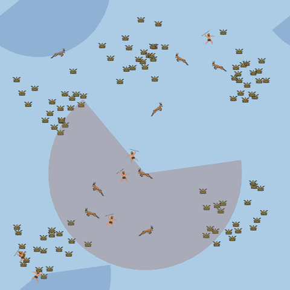

# non_evolutionary

<p align="center">
  
</p>

*Continuous-space simulation from [PredPreyGrassContinuous](https://github.com/doesburg11/PredPreyGrassContinuous):
`add_walls` with walls disabled, using policies trained in run T (speed actions,
fixed energy cost). Shaded cones show one predator's and one prey's field of view.*

Non-evolutionary experiments: agent traits are fixed rather than inherited with mutation;
learning agents adapt through RL policies (usually PPO). Populations can still reproduce
and die, and some experiments use scripted agents or fixed populations.

## Directory structure

Environments are grouped first by their spatial model. The two grouped research
projects live inside `discrete_space/`.

```text
non_evolutionary/
├── discrete_space/
│   ├── base_environment_discrete/
│   ├── base_environment_seasonal/
│   ├── base_environment_step_energy/
│   ├── drive_conditioned_environment/
│   ├── predator_sexual_reproduction/
│   ├── predator_complementary_diet/
│   ├── predator_bands/
│   ├── red_queen/
│   ├── walls_occlusion/
│   ├── project_cooperation/
│   ├── project_reward_shaping/
│   ├── random_source.py
│   └── tests/
└── continuous_space/
    ├── base_environment_continuous/
    ├── foraging_swarms/
    └── selfish_flocking/
```

Use the full spatial grouping in new imports and module commands:

- Discrete environments: `predpreygrass.non_evolutionary.discrete_space.<environment>`.
- Grouped experiments: `predpreygrass.non_evolutionary.discrete_space.project_cooperation.<environment>`
  or `predpreygrass.non_evolutionary.discrete_space.project_reward_shaping.<environment>`.
- Continuous environment: `predpreygrass.non_evolutionary.continuous_space.base_environment_continuous`.

For example, from the repository root after installation:

```bash
python -m predpreygrass.non_evolutionary.discrete_space.base_environment_discrete.random_policy
python -m predpreygrass.non_evolutionary.continuous_space.base_environment_continuous.eval --help
```

The package retains the former `predpreygrass.non_evolutionary.<environment>`
and `predpreygrass.non_evolutionary.project_cooperation.<environment>` /
`predpreygrass.non_evolutionary.project_reward_shaping.<environment>` paths for
saved checkpoints and older callers. These are compatibility imports; the source
files live under the spatial directories above.

## Discrete-space environments

All modules in the following sections live in [`discrete_space/`](discrete_space/).

### The predator_* lineage: humans, one addition at a time

Three modules build on each other in sequence, each a clone of the previous with earlier results left unchanged.
This is the project's main line for the human-cooperation research angle (predators standing in for humans):

1. **[`predator_sexual_reproduction`](discrete_space/predator_sexual_reproduction/)** — **CLOSED (2026-09-25).** Sexed predators
   (male/female), two-parent reproduction, an asymmetric birth cost, sex-specific hunting odds (males 90% success,
   females 20%), a male-to-mate gift, parental care. Headline result: males learn to hunt and females to gather
   fruit — a learned sexual division of labor, driven mainly by hunting success rate, not death risk. See its
   [`RESULTS.md`](discrete_space/predator_sexual_reproduction/RESULTS.md) for the full 16-iteration writeup and the two questions
   it could not answer.
2. **[`predator_complementary_diet`](discrete_space/predator_complementary_diet/)** — a clone of `predator_sexual_reproduction`
   with one addition: predators need *both* meat and fruit to survive (separate stores, either can starve them),
   `diet_meat_cost_share` tunable. Status as of its README: under calibration, not yet a viable population on its
   own pilots — but it became the base for `predator_bands` regardless.
3. **[`predator_bands`](discrete_space/predator_bands/)** — a clone of `predator_complementary_diet` with **band living** added:
   sharing, kin exclusion, marriage, roaming threats, mammoth hunts, band fission/fusion/drift, and (most recently) a
   free-rider reputation mechanic. This is the active module: see its README's status table and
   [`RESULTS.md`](discrete_space/predator_bands/RESULTS.md) for the running list of what has and hasn't produced learned cohesion.
   Design doc: [`BANDS_DESIGN.md`](discrete_space/predator_complementary_diet/BANDS_DESIGN.md).

### Other discrete modules

| Module | What it is |
| --- | --- |
| [`base_environment_discrete`](discrete_space/base_environment_discrete/) | The plain Predator-Prey-Grass environment: no sexes, no diet, no bands — the common ancestor everything else in this folder ultimately traces back to. |
| [`base_environment_seasonal`](discrete_space/base_environment_seasonal/) | `base_environment_discrete` + grass regrowth cycling between an "abundant" and a "scarce" phase over an episode. |
| [`base_environment_step_energy`](discrete_space/base_environment_step_energy/) | `base_environment_discrete` + a real movement energy cost (the base module charges the same per-step tax regardless of action; this module makes moving itself cost more). See its `RESULTS.md`. |
| [`drive_conditioned_environment`](discrete_space/drive_conditioned_environment/) | `base_environment_discrete` + internal drive state conditioning behavior; still close to baseline by design, built incrementally. |
| [`red_queen`](discrete_space/red_queen/) | Tests the Red Queen Hypothesis — an agent must keep adapting to maintain *relative* fitness against a coevolving opponent, not an absolute score. |
| [`walls_occlusion`](discrete_space/walls_occlusion/) | Walls and line-of-sight occlusion experiments. |

### Grouped sub-projects (their own index READMEs)

- **[`project_cooperation/`](discrete_space/project_cooperation/README.md)** — every module whose core mechanic is cooperation
  between fixed-trait agents: joint/team action, cooperate-vs-defect dilemmas with free-riding,
  reputation-conditioned cooperation, direct/spatial/network reciprocity, kin-selection altruism (direct_reciprocity,
  lineage_rewards, mammoths, mammoths_defection, network_reciprocity, pack_hunt_opponent_shaping, shared_prey,
  stag_hunt and its variants).
- **[`project_reward_shaping/`](discrete_space/project_reward_shaping/README.md)** — one connected investigation into sparse vs.
  dense reward shaping on `base_environment_discrete`; five trained sibling environments; headline result: reward shaping
  should be minimized here, not maximized.

## Continuous-space experiments

[`continuous_space/selfish_flocking/`](continuous_space/selfish_flocking/README.md)
is a separate reproduction of Hahn et al.'s SELFish predator-escape task:
fixed-population prey learn to survive one pursuing predator, with no grass,
reproduction, or energy mechanics.

[`continuous_space/base_environment_continuous/`](continuous_space/base_environment_continuous/README.md)
is a standalone RLlib environment with steering physics on a torus, direction and
speed actions, movement energy costs, and moving grass clusters. It replaces the
Aquarium-based implementation. Its training runs show a Red Queen arms race between
predators and prey; see [`RESULTS.md`](continuous_space/base_environment_continuous/RESULTS.md)
for the experiments and [`SPEC.md`](continuous_space/base_environment_continuous/SPEC.md)
for the environment rules.

[`continuous_space/foraging_swarms/`](continuous_space/foraging_swarms/README.md)
studies whether social movement emerges in the Predator-Prey-Grass ecology; it is
not an implementation of either SELFish paper.
