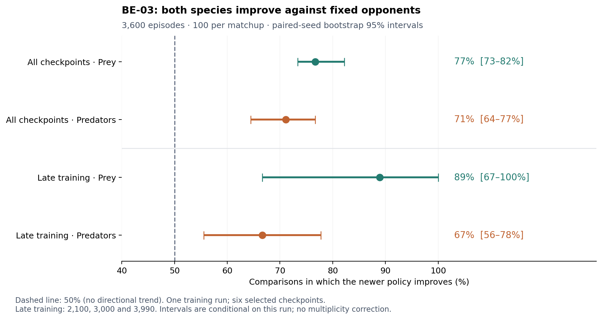

# base_environment_continuous

A continuous-space Predator-Prey-Grass environment for RLlib: predators
(hunters) and prey (antelopes) move with steering physics on an 800 × 800
torus, prey graze grass clusters that move as they are grazed, both
species pay energy to live and to move, starve at zero energy and give
birth at an energy threshold. Each agent chooses one of 16 directions at
full speed, half speed or standing still, and sees the nearest animals and
grass patch in its view cone. The only reward is +10 per birth, as in
[`base_environment_discrete`](../base_environment_discrete/).

The environment was developed in the
[PredPreyGrassContinuous](https://github.com/doesburg11/PredPreyGrassContinuous)
repository, first on top of the physics-based
[Aquarium](https://github.com/michaelkoelle/marl-aquarium) package
(unmaintained since 2024) with a stack of patches (its `add_walls`
module), then as this standalone `MultiAgentEnv` without Aquarium or
PettingZoo. It contains the world of that repository's milestone runs
(AW-17 to AW-22): no walls, 75% of the energy cost at full speed from
movement (Taylor, Heglund & Maloiy 1982), prey a little faster than
predators, and grass in 20 small clusters. In that world predators and prey
keep improving against each other for about 2,000 training iterations, a
Red Queen arms race.

By default it reproduces `add_walls` **exactly**, including Aquarium's
quirks, so the results obtained there remain valid here.
[SPEC.md](SPEC.md) records every rule. Section 9 lists the quirks, each
with a `fix_*` setting in `config/config_env.py` that removes it (all off by
default; `environment.FIXES` turns them all on).

## Files

- [`environment.py`](environment.py): `PredPreyGrassContinuous`, an RLlib
  `MultiAgentEnv` (animals, physics, energy, reproduction, observations,
  decisions).
- [`grass.py`](grass.py): grass patches, seed dispersal and overgrazing.
- [`geometry.py`](geometry.py): 2D vectors and torus distances, offsets and
  view cones.
- [`config/config_env.py`](config/config_env.py) and
  [`config/config_ppo.py`](config/config_ppo.py): settings for training.
- [`train.py`](train.py): PPO training, one policy per species.
- [`eval.py`](eval.py) with [`config/config_eval.py`](config/config_eval.py):
  play a trained checkpoint (or random actions) in a window, to an mp4, or
  without rendering.
- [`render.py`](render.py): the pygame viewer (hunters and antelopes facing
  their direction of movement, grass, one predator's and one
  prey's view cone, and the populations over the episode). It only reads
  the state, so watching never changes an episode.
- [`tournament.py`](tournament.py): every predator checkpoint of a run
  against every prey checkpoint, to see an arms race.
- [`checkpoints.py`](checkpoints.py): a checkpoint's settings and policies.
- [`analysis/arms_race_three_runs.py`](analysis/arms_race_three_runs.py):
  the arms-race test over BE-01, BE-02 and BE-03 (tables, figure).
- [`analysis/arms_race_quirks_fixed.py`](analysis/arms_race_quirks_fixed.py):
  the same test for BE-04 and BE-05 (every quirk fixed) next to BE-01 to
  BE-03.
- [`analysis/final_check.py`](analysis/final_check.py): final check of a
  trained checkpoint (outcomes, catch risk, populations, speed choices,
  time and catches near grass).
- [`assets/`](assets/): the sprites.
- [`tests/`](tests/): the regression test against `add_walls` and unit
  tests.

## Usage

From the repository root:

```bash
python predpreygrass/non_evolutionary/base_environment_continuous/train.py
python predpreygrass/non_evolutionary/base_environment_continuous/eval.py
python predpreygrass/non_evolutionary/base_environment_continuous/tournament.py \
    predpreygrass/non_evolutionary/base_environment_continuous/runs/<run> --every 300
python -m pytest predpreygrass/non_evolutionary/base_environment_continuous/tests
```

Training and evaluation take no command-line arguments: edit the config
files. Runs are saved in the module's `runs/` folder (gitignored;
`RUNS_DIR` in `config/config_ppo.py`), each with a copy of the code and
settings it was started with in `source_code/`. Videos are written with
OpenCV (mp4v); on a machine without a display, set `SDL_VIDEODRIVER=dummy`.

## How the equivalence was checked

- In the development repository, `tests/test_equivalence.py` records
  trajectories of `add_walls`'s environment with random actions, replays
  the same actions here and compares every decision bit for bit:
  observations, rewards, flags, infos and the full state, including the
  random-number generators. 61 episodes, about 12,500 decisions, covering
  births, catches, starvation, grass collapse, extinction, the time limit,
  one physics step per decision, population caps and exhausted ID pools.
- Here, [`tests/test_regression.py`](tests/test_regression.py) checks the
  same trajectories without `add_walls` or Aquarium, against a digest of
  every decision of `add_walls`'s results
  ([`tests/data/reference_digests.json`](tests/data/reference_digests.json)).
  It also passes with this repository's NumPy 1.26 and Torch 2.13 (the
  development repository uses NumPy 2.4 and Torch 2.14).
- Run AW-21's trained policies played the same 50 seeded episodes in both
  environments with identical results (55,298 decisions, 21,873 births,
  19,860 catches).

Two deliberate differences, neither affecting the dynamics: with
`reset(seed=None)` each environment has its own spawn stream instead of
Python's process-global one, and the keys of the returned dictionaries come
in a different order.

## Validation runs

BE-01 and BE-02 trained the milestone world from scratch with this
environment (3,000 iterations, 14 simulation workers each, side by side),
as AW-21 and AW-22 did with `add_walls`. They reached the same state: both
species survived in 72 of 100 evaluation episodes (35 and 37 of 50 per
run) against 71 of 100 for AW-21 and AW-22 (33 and 38 of 50), the same catch risk, populations and behaviour
(predators waiting near grass), and the same arms race. Details in
[RESULTS.md](RESULTS.md). Their run folders are in `runs/`;
`config/config_eval.py` plays BE-01's final policies by default.

Training took 8–15% less wall time than with `add_walls` (about 9 hours
instead of 10 for 3,000 iterations): the environment plays episodes about
twice as fast, but the learner takes most of the time.

BE-01 and BE-02 were trained in the development repository under NumPy 2.
RLlib cannot restore such checkpoints under this repository's NumPy 1.26,
so `checkpoints.py` then rebuilds RLlib's default PPO network, which
`train.py` always uses, from the run's saved settings and loads the
trained weights, refusing any mismatch in their names or shapes. For BE-01
the rebuilt policies give bit-identical outputs, and its 50-episode final
check gives identical episodes in both repositories.

## Arms-race test: BE-03

BE-03 trained both species from scratch for 4,000 iterations. A cross-play
tournament provides strong evidence of an arms race **within this run**:
newer prey evade fixed predators better, and newer predators catch fixed
prey better. Both trends persist in late training.



The tournament crossed six predator checkpoints with the same six prey
checkpoints (iterations 300, 900, 1,800, 2,100, 3,000 and 3,990), playing
100 episodes per matchup: **3,600 episodes** in total. Each matchup used
the same 100 fresh evaluation seeds (10,000–10,099), with sampled actions
and the saved training environment settings. Iteration 3,990 is the last
numbered checkpoint in the 4,000-iteration run.

Improvement means lower catch risk for newer prey against the same predator,
or higher catch risk for newer predators against the same prey. Catch risk
is prey caught per prey alive per 1,000 physics steps, pooled over episodes.
The chart shows the fraction of checkpoint comparisons that improve,
averaging equally over checkpoint pairs and fixed opponents (ties receive
half credit). The full tournament gives **77% for prey (95% interval:
73–82%)** and **71% for predators (64–77%)**.

Restricting both species and their fixed opponents to iterations 2,100,
3,000 and 3,990 gives **89% for prey (67–100%)** and **67% for predators
(56–78%)**. All four intervals exceed the 50% no-directional-trend
benchmark. Average catch-risk changes also support late improvement:
newer prey reduce risk by 0.292 (95% interval: 0.209–0.375), while newer
predators increase it by 0.100 (0.022–0.178), in the catch-risk units above.
This supports continued co-adaptation through late training, with smaller
late predator gains, rather than a complete plateau.

Intervals use 10,000 paired-seed bootstrap replicates: each replicate
resamples episode seeds jointly across every matchup, preserving the
pairing and dependence between comparisons. These are pointwise 95%
intervals without a multiplicity correction, conditional on this training
run and these selected checkpoints. They quantify evaluation uncertainty;
the repeat over three runs is in the next section.
The numerical results are saved in
[`analysis/results/be03_arms_race.json`](analysis/results/be03_arms_race.json).

Reproduce the tournament from the repository root, with `RUN` set to
`predpreygrass/non_evolutionary/base_environment_continuous/runs/base_environment_continuous_2026-10-14_00-27-11_018144`:

```bash
python -m predpreygrass.non_evolutionary.base_environment_continuous.tournament \
    "$RUN" --iterations 300,900,1800,2100,3000,3990 \
    --episodes 100 --seed 10000 --workers 30 --out "$RUN/tournament_100ep.csv"
```

## Arms race in three runs

The same test on an evenly spaced grid, repeated in BE-01, BE-02 and BE-03:
in each run, checkpoints 300, 600, ..., 2,700 and 2,990 play against each
other, 100 episodes per matchup with the same seeds (30,000 episodes in
all). The three runs have the same environment and PPO settings; BE-03 is cut at 2,990 to
match the others.


The same directional pattern appears **in all three runs**: over all
checkpoints, newer prey evade fixed predators better (90%, 96% and 69% of
comparisons) and newer predators catch fixed prey better (80%, 72% and
72%), all intervals well above 50%. Late in training (2,100–2,990)
predators still improve in all three runs and prey in BE-01 and BE-02; for
BE-03's prey, which make most of their gain by iteration 600, the late
window shows no clear evidence of further improvement.
Whether that comes from BE-03's 28 simulation workers (BE-01 and BE-02: 14)
or is ordinary variation between runs is open. Details in
[RESULTS.md](RESULTS.md), section 2; reproduce with
`python -m predpreygrass.non_evolutionary.base_environment_continuous.analysis.arms_race_three_runs`
after running `tournament.py` with `--iterations 300,600,900,1200,1500,1800,2100,2400,2700,2990
--episodes 100 --seed 10000 --out <run>/tournament_grid300_100ep.csv` on each run.

## Without Aquarium's quirks: BE-04 and BE-05

BE-04 and BE-05 trained the same world with every quirk of SPEC.md section
9 fixed (`environment.FIXES`), the design of BE-01 and BE-02. The arms race
remains (over all checkpoints, newer prey evade fixed predators better in
84% and 97% of comparisons, newer predators catch fixed prey better in 83%
in both), and 47 and 46 of 50 final-check episodes ended with both species
alive (BE-01 to BE-03: 35, 37 and 43). The balance in these runs is
shifted towards the prey: predators catch about half as often, and prey are
almost twice as numerous. Late in training BE-05 still improves strongly in
both species; BE-04 is the only run of the five in which neither does.
These runs were also trained with a different repository and Ray version
than BE-01 and BE-02, so whether the quirks cause the shift is not yet
established.
Details in [RESULTS.md](RESULTS.md), section 3.


