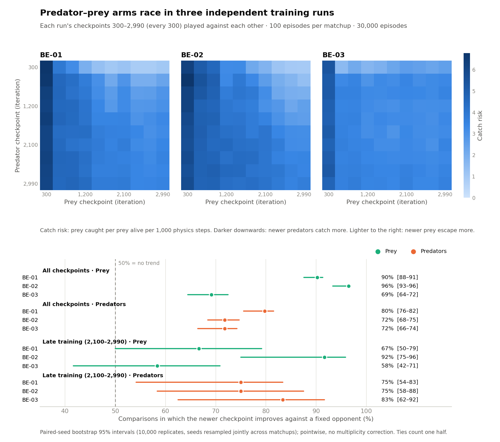
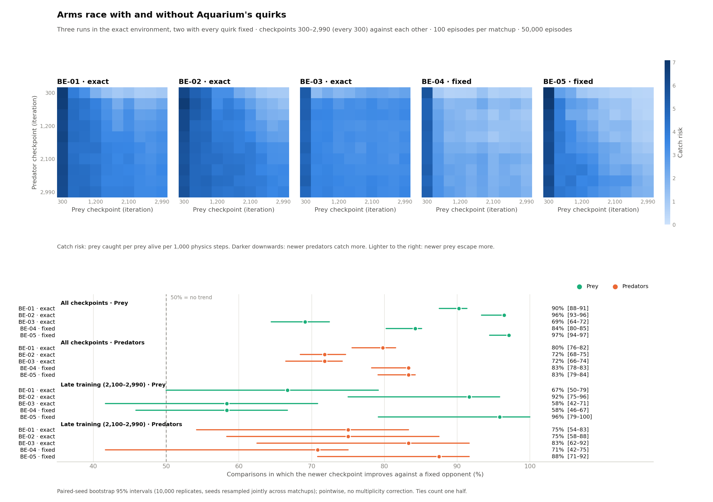

# base_environment_continuous: results

## Runs

**Setup.** All five runs train the milestone world from scratch with the
same PPO settings (constant learning rate 3e-4, 4,800 steps per iteration,
one shared policy per species).

| Run | Folder (`runs/base_environment_continuous_...`) | Environment | Trained in | Ray | Simulation workers | Iterations | Purpose |
|---|---|---|---|---|---:|---:|---|
| BE-01 | `2026-10-13_11-25-07_420466` | exact (`add_walls`'s quirks) | development repository | 2.58 | 14 | 3,000 | validation against `add_walls` (as AW-21 and AW-22) |
| BE-02 | `2026-10-13_11-25-27_332055` | exact | development repository | 2.58 | 14 | 3,000 | replicate of BE-01 (new training randomness) |
| BE-03 | `2026-10-14_00-27-11_018144` | exact | this repository | 2.59 | 28 | 4,000 | longer training; arms-race test |
| BE-04 | `2026-10-14_21-35-19_937331` | every quirk fixed (`environment.FIXES`, SPEC.md section 9) | this repository | 2.59 | 14 | 3,000 | do coexistence and the arms race survive without the quirks? |
| BE-05 | `2026-10-14_21-35-40_020808` | every quirk fixed | this repository | 2.59 | 14 | 3,000 | replicate of BE-04 (new training randomness) |

BE-01 and BE-02 ran side by side, as did BE-04 and BE-05; BE-03 had the
machine to itself.

**Outcome.**

| Run | Status | Wall time | Settled at iteration | Episodes per iteration at the end | Final check: coexisting | Newer prey harder to catch | Newer predators catch more |
|---|---|---:|---:|---:|---:|---:|---:|
| BE-01 | completed | 9.1 h | 1,653 | 4.4 | 35 of 50 | 90% (88–91) | 80% (76–82) |
| BE-02 | completed | 8.9 h | 2,270 | 4.8 | 37 of 50 | 96% (93–96) | 72% (68–75) |
| BE-03 | completed | 8.8 h (4,000 iterations) | 347 | 4.2 | 43 of 50 | 69% (64–72) | 72% (66–74) |
| BE-04 | completed | 14.2 h | 371 | 4.1 | 47 of 50 | 84% (80–85) | 83% (78–83) |
| BE-05 | completed | 12.7 h | 1,366 | 4.1 | 46 of 50 | 97% (94–97) | 83% (79–84) |

*Settled at iteration:* the first iteration from which the mean number of
episodes per iteration over the next 100 iterations is at most 5, i.e.
most episodes last the full time limit instead of ending in an extinction.
*Episodes per iteration at the end:* mean over the last 100 iterations.
*Final check:* 50 evaluation episodes of the final policies (section 1;
BE-03's final policies are those of iteration 4,000).
The last two columns: share of comparisons against a fixed opponent in
which the newer checkpoint does better, checkpoints 300–2,990, with 95%
intervals (section 2).

BE-01 and BE-02 were trained in the [PredPreyGrassContinuous](https://github.com/doesburg11/PredPreyGrassContinuous)
development repository; the run folders, launchers (`be01.py`, `be02.py`), evaluation
script (`evaluate_be.sh`, which refers to that repository's paths) and outputs are
in this module's `runs/` folder (gitignored). AW-21 and AW-22
are runs of that repository's `add_walls` module.

## 1. Validation against add_walls (runs BE-01 and BE-02)

**Question.** This environment reproduces `add_walls` exactly for the same
seeds and actions (SPEC.md, section 10). Does training with it also give the
same result as training with `add_walls`?

**Setup.** BE-01 and BE-02 train the milestone world (no walls, 75% of the
energy cost from movement, prey top speed 6.0, grass in 20 clusters of 5)
from scratch for 3,000 iterations, side by side on 14 simulation workers
each, exactly as `add_walls` runs AW-21 and AW-22 did. Same PPO settings;
training randomness is not seeded, so the runs can only agree
statistically.

**Learning curves**, per episode in blocks of 500 iterations (predator
births / prey births / episode length in decisions; births are the policy
returns divided by the +10 birth reward):

| Iterations | AW-21 | AW-22 | BE-01 | BE-02 |
|---|---|---|---|---|
| 1–500 | 7.7 / 56 / 152 | 10.8 / 102 / 283 | 10.0 / 88 / 242 | 9.5 / 82 / 228 |
| 501–1000 | 10.2 / 98 / 257 | 18.9 / 217 / 590 | 17.5 / 193 / 529 | 11.1 / 109 / 287 |
| 1001–1500 | 16.6 / 193 / 522 | 27.2 / 336 / 917 | 25.4 / 304 / 833 | 14.7 / 155 / 419 |
| 1501–2000 | 26.1 / 329 / 899 | 29.7 / 373 / 1,023 | 28.7 / 351 / 966 | 20.9 / 241 / 662 |
| 2001–2500 | 29.6 / 384 / 1,043 | 31.7 / 403 / 1,102 | 31.1 / 385 / 1,058 | 27.9 / 345 / 944 |
| 2501–3000 | 31.0 / 394 / 1,072 | 31.5 / 403 / 1,102 | 32.0 / 403 / 1,103 | 29.9 / 374 / 1,023 |

BE-01 learned about as fast as AW-22, BE-02 about as slowly as AW-21: the
same spread between replicates. All four ended near 30–32 predator births,
375–405 prey births and 1,020–1,100 decisions per episode.

**Final checks after 3,000 iterations** (50 episodes, seeds 0–49).
All four runs measured with the same script (`analysis/final_check.py`) in
this environment, with the same seeds and action sampling. Checkpoints of
`add_walls` runs play identically here, so this compares training, not
environments. (AW-21 and AW-22 score 33 and 38 here against 37 and 41 in
`add_walls`'s [RESULTS.md](https://github.com/doesburg11/PredPreyGrassContinuous/blob/master/add_walls/RESULTS.md),
because the actions are sampled differently.)

| | AW-21 | AW-22 | BE-01 | BE-02 |
|---|---:|---:|---:|---:|
| Coexisting | 33 | 38 | 35 | 37 |
| Prey extinct | 17 | 12 | 15 | 13 |
| Predators extinct | 0 | 0 | 0 | 0 |
| Catch risk (per prey per 1,000 steps) | 3.67 | 3.46 | 3.63 | 3.74 |
| Predators / prey alive on average | 11.6 / 16.1 | 11.6 / 16.3 | 11.4 / 15.8 | 11.7 / 14.9 |
| Predators stopped | 45% | 44% | 41% | 47% |
| Predators' time near grass | 39% | 40% | 39% | 38% |
| Prey's time near grass | 21% | 20% | 21% | 21% |
| Catches near grass | 44% | 45% | 46% | 46% |

"Near grass": within 64 units of an available patch.

**Tournaments** (checkpoints every 300 iterations, 10 episodes per matchup;
share of pairs against a fixed opponent in which the newer checkpoint does
better):

| Run | Newer prey harder to catch | Newer predators catch more |
|---|---:|---:|
| AW-21 | 89% | 64% |
| AW-22 | 79% | 71% |
| BE-01 | 86% | 76% |
| BE-02 | 85% | 65% |

Catch risk of each checkpoint against its own training partner fell from
6.2 and 6.9 at iteration 300 to about 3.4–3.8 from iteration 1,200 on (BE-01
and BE-02), while both species kept improving against fixed opponents: the
same Red Queen pattern as in AW-21 and AW-22.

**Wall time:** 9.1 and 8.9 hours for 3,000 iterations, against 9.9 and
10.5 hours for AW-21 and AW-22 (8–15% less; the learner takes most of the
time, and the environment itself plays about twice as fast).

**Conclusion:** trained with this environment, the milestone world reaches
the same state as with `add_walls`: 72 of 100 episodes coexisting (two
runs of 50) against 71 of 100, the same catch risk, populations and behaviour (predators
waiting near grass, about 45% of catches there), and the same arms race.
The environment can replace `add_walls` for this world.

## 2. Arms race in three runs (BE-01, BE-02, BE-03)

**Question.** BE-03's cross-play tournament showed newer prey evading fixed
predators better and newer predators catching fixed prey better (README,
"Arms-race test: BE-03"). Does that hold in independent training runs?

**Method.** In each run, the predator and prey checkpoints 300, 600, ...,
2,700 and 2,990 (every 300 iterations; 2,990 is BE-01's and BE-02's last)
play against each other: 100 matchups of 100 episodes, seeds 10,000–10,099,
sampled actions, 30,000 episodes in all. The three runs have the same
environment and PPO settings (constant learning rate, 4,800 steps per
iteration), so BE-03 up to iteration 2,990 is comparable with the other two.
They differ in the number of simulation workers (28 against 14) and the Ray
version (2.59 against 2.58). Catch risk, improvement shares and the
paired-seed bootstrap are as in BE-03's test; "late" restricts both species
and their fixed opponents to 2,100, 2,400, 2,700 and 2,990.
[`analysis/arms_race_three_runs.py`](analysis/arms_race_three_runs.py)
computes everything from the runs' `tournament_grid300_100ep.csv` and writes
[`analysis/results/arms_race_three_runs.json`](analysis/results/arms_race_three_runs.json)
and the figure.

**Improvement shares** (% of comparisons against a fixed opponent in which
the newer checkpoint does better; 95% intervals):

| Run | Prey, all | Predators, all | Prey, late | Predators, late |
|---|---:|---:|---:|---:|
| BE-01 | 90 (88–91) | 80 (76–82) | 67 (50–79) | 75 (54–83) |
| BE-02 | 96 (93–96) | 72 (68–75) | 92 (75–96) | 75 (58–88) |
| BE-03 | 69 (64–72) | 72 (66–74) | 58 (42–71) | 83 (62–92) |

**Mean catch-risk change** (prey: reduction by newer prey; predators:
increase by newer predators; 95% intervals):

| Run | Prey, all | Predators, all | Prey, late | Predators, late |
|---|---:|---:|---:|---:|
| BE-01 | 1.15 (1.12–1.18) | 0.56 (0.54–0.59) | 0.14 (0.07–0.21) | 0.08 (0.03–0.14) |
| BE-02 | 1.27 (1.24–1.31) | 0.50 (0.47–0.53) | 0.36 (0.27–0.46) | 0.16 (0.08–0.24) |
| BE-03 | 0.40 (0.37–0.42) | 0.27 (0.25–0.29) | 0.01 (−0.03–0.06) | 0.14 (0.07–0.20) |

**Results.**

- Over all checkpoints, both species improve against fixed opponents in all
  three runs; every interval lies well above 50%.
- Late in training (2,100–2,990), predators still improve in all three runs
  (catch-risk intervals above zero). Prey still improve in BE-01 and BE-02;
  in BE-03 the late window shows no clear evidence of prey improvement
  (mean risk reduction 0.01, interval −0.03 to 0.06).
- BE-03's prey make most of their gain between iterations 300 and 600: in
  its catch-risk matrix, values within each predator row vary little and
  without a clear trend across prey checkpoints from 600 on (against the
  2,990 predator, 3.60 for prey 600 and 3.60 for prey 2,990).
  In BE-01 and BE-02 newer prey keep getting harder to catch (against the
  300 predator, catch risk falls from 6.78 to 1.03 and from 6.24 to 0.93).
  BE-03's own 4,000-iteration tournament found its prey improving again
  between iterations 3,000 and 3,990, beyond this grid.
- Across the whole cross-play grid (all 100 matchups, not only the final
  checkpoints), 7,143 of BE-03's 10,000 episodes reach the time limit with
  both species alive, against 4,481 (BE-01) and 2,680 (BE-02).
- Episodes are reproducible: the 2,500 matchup episodes each run shares with
  an earlier five-checkpoint tournament (same seeds) are identical row for row.

**Conclusion.** The same directional pattern appears in all three
independent runs: newer predators catch fixed prey better and newer prey
evade fixed predators better, as expected under an arms race between the
two species (improvement against past opponents is consistent with
co-adaptation, but does not by itself show that each species' improvement
is driven by the other's). Predators improve up to iteration 2,990 in all
three runs; for the prey this holds in BE-01 and BE-02, while BE-03's prey
show no clear late improvement. Whether BE-03's difference comes from its
28 simulation workers or is ordinary variation between runs cannot be told
from three runs. The intervals are pointwise, without a multiplicity
correction, and resample evaluation seeds within each run: they describe
each run, not the variation between training runs.

## 3. Without Aquarium's quirks (runs BE-04 and BE-05)

**Question.** The environment keeps eight quirks of Aquarium so that it
reproduces `add_walls` exactly (SPEC.md, section 9): animals move one after
another on partly updated positions, prey and predators bump differently,
only the first contact counts, a stopped animal's view cone swings to an
arbitrary direction, edges clamp instead of wrapping, and smaller
bookkeeping differences. Do coexistence and the arms race depend on them?

**Setup.** BE-04 and BE-05 train the same world with every quirk fixed
(`environment.FIXES`), from scratch, 3,000 iterations, 14 simulation workers
each, side by side: the design of BE-01 and BE-02. Final check and
tournament as for the other runs (sections 1 and 2), each played in the
run's own environment.
[`analysis/arms_race_quirks_fixed.py`](analysis/arms_race_quirks_fixed.py)
writes [`analysis/results/arms_race_quirks_fixed.json`](analysis/results/arms_race_quirks_fixed.json)
and the figure.

**Final checks** (50 episodes each):

| Run | Environment | Coexisting | Prey extinct | Predators extinct | Catch risk | Predators / prey alive on average | Predators stopped | Catches near grass |
|---|---|---:|---:|---:|---:|---:|---:|---:|
| BE-01 | exact | 35 | 15 | 0 | 3.63 | 11.4 / 15.8 | 41% | 46% |
| BE-02 | exact | 37 | 13 | 0 | 3.74 | 11.7 / 14.9 | 47% | 46% |
| BE-03 | exact | 43 | 7 | 0 | 3.20 | 11.6 / 17.1 | 43% | 46% |
| BE-04 | fixed | 47 | 1 | 2 | 1.93 | 10.6 / 27.1 | 44% | 41% |
| BE-05 | fixed | 46 | 1 | 3 | 1.69 | 10.4 / 28.8 | 48% | 44% |

**Tournaments** (checkpoints 300–2,990, every 300; % of comparisons in
which the newer checkpoint does better against a fixed opponent, and mean
catch-risk change; 95% intervals):

| Run | Prey, all | Predators, all | Prey, late | Predators, late | Prey risk reduction, late | Predator risk increase, late |
|---|---:|---:|---:|---:|---:|---:|
| BE-04 | 84 (80–85) | 83 (78–83) | 58 (46–67) | 71 (42–75) | 0.05 (−0.03–0.14) | 0.05 (−0.03–0.13) |
| BE-05 | 97 (94–97) | 83 (79–84) | 96 (79–100) | 88 (71–92) | 0.54 (0.44–0.64) | 0.37 (0.28–0.46) |

For the exact runs see section 2.

**Results.**

- Coexistence rose: 93 of 100 final-check episodes in the two runs without
  quirks, against 115 of 150 in the three exact runs (72 of 100 in BE-01
  and BE-02, trained the same way). Treating episodes as independent,
  Fisher's exact test gives p = 0.0005; this ignores variation between
  training runs, of which there are only two and three.
- Predators catch about half as often: catch risk 1.69–1.93 against
  3.20–3.74, with nearly twice as many prey alive (27–29 against 15–17) and
  slightly fewer predators. Prey extinctions became rare (2 of 100) and
  predator extinctions appeared (5 of 100, none in the exact runs).
- The predators' behaviour hardly changed: stopped 44–48% of the time, near
  grass 38–39% of the time (exact runs: 41–47% and 38–39%), 41–44% of
  catches near grass (46%).
- The arms race remains: over all checkpoints both species improve against
  fixed opponents in both runs, predators by 83% in each, at least as
  clearly as in the exact runs. Late in training, BE-05 shows the strongest
  continued improvement of all five runs in both species, while in BE-04
  neither species improves clearly (both catch-risk intervals include
  zero), the same variation between runs as among the exact runs (BE-02
  against BE-03).
- Training took longer: 12.7 and 14.2 hours, against 8.9 and 9.1 for BE-01
  and BE-02 (longer episodes, fewer extinctions, and slower physics; not
  separated).

**Confounds.** Besides the quirks, BE-04 and BE-05 differ from BE-01 and
BE-02 in where they were trained (this repository, Ray 2.59, against the
development repository, Ray 2.58). BE-03 shares this repository and Ray
version with them and still looks like BE-01 and BE-02 (catch risk 3.20,
17 prey on average), so these differences are unlikely to explain the
shift; BE-03 differs in turn in its 28 simulation workers and 4,000
iterations.

**Conclusion.** In these runs, removing the quirks kept the arms race and
went with a more stable ecosystem shifted towards the prey: predators catch
about half as often and prey are almost twice as numerous. Which quirk
favoured the predators is not known; each can be switched on separately to
find out. Candidates are the sequential movement order and the prey's
collision rule, which stopped prey from steering while they touched another
prey. Two runs per environment show the direction of the change, not its
size precisely.
