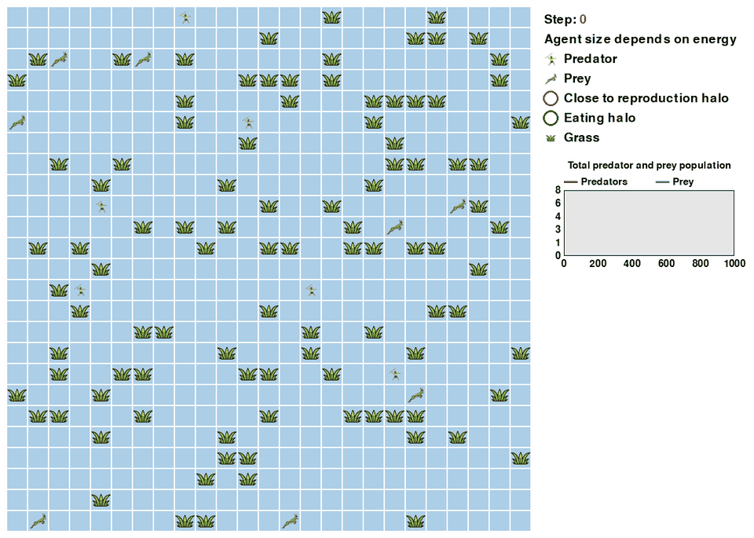

# Predator-Prey-Grass base environment — seasonal variant

A controlled experiment on **coexistence under fluctuating food supply**. This
module keeps the ecology of [`base_environment_discrete`](../base_environment_discrete/README.md)
and alternates grass regrowth between abundant and scarce phases. Traits remain
fixed; predator and prey policies learn through PPO.

**Status: the six-regime training sweep is complete.** Trained populations of both
species can persist through the approximately 1,000-step episode limit under the
current defaults. This makes the module useful as a robustness experiment. It does
not yet establish that policies anticipate seasons, or that seasonality improves
learning or ecological outcomes across independent training seeds.

## Trained simulation

<p align="center">
    
</p>

*Trained seasonal predator and prey policies from the final checkpoint
(`checkpoint_000049`, 500 training iterations) of
`BASE_ENV_SEASONAL_HIGH1.5_LOW0.5_2026-08-07_05-26-24`, evaluated with seed 42
and deterministic actions. Grass regrowth alternates between 1.5× and 0.5×
every 40 steps. Every fourth simulation step is shown at 10 frames per second;
the population chart uses actual simulation steps, with red for predators and blue for prey.*

The displayed default-regime rollout reaches step 1,000 with **16 predators and
38 prey** remaining. This is one deterministic evaluation with seed 42, separate
from the aggregated training metrics below. Individual agents die and reproduce;
coexistence refers to the populations, not survival of every starting agent.

## What this experiment tests

The question is whether a learned predator–prey ecosystem can remain viable when
resource regeneration varies periodically. It extends the flat-food baseline with
one environmental change, making it a useful starting point for studying
predictable scarcity.

All six tested multiplier pairs average to 1.0 over a complete 80-step cycle.
This holds the nominal cycle-average regrowth rate constant while changing its
amplitude. It does **not** guarantee identical food availability: grass energy is
capped, grazing differs between policies, and a 1,000-step episode does not end
on a complete cycle. Seasonal timing and realized resource supply both matter.

## Seasonal grass-regrowth cycle

`energy_gain_per_step_grass` is multiplied by `season_high_multiplier` for
`season_length_steps` steps, then by `season_low_multiplier` for the next
`season_length_steps` steps, repeating for the rest of the episode (a square wave, computed
purely from the env's own per-episode step counter — see `_current_season_multiplier()` in
`predpreygrass_rllib_env.py`). At each step: `phase = (current_step // season_length_steps) % 2` —
phase 0 uses the high multiplier, phase 1 uses the low one.

Three config keys in [`config_env.py`](config_env.py) control it:

| Key | Default | Meaning |
| --- | --- | --- |
| `season_length_steps` | 40 | how many env steps each phase lasts (a full cycle is 80 steps) |
| `season_high_multiplier` | 1.5 | multiplier during the "abundant" phase |
| `season_low_multiplier` | 0.5 | multiplier during the "scarce" phase |

With the defaults, grass regrows at 0.06/step for steps 0-39, 0.02/step for steps 40-79,
0.06/step again for 80-119, and so on.

**Equivalence to `base_environment_discrete`:** setting *both* `season_high_multiplier = 1.0` and
`season_low_multiplier = 1.0` makes this module behave exactly like `base_environment_discrete` — the
multiplier always evaluates to 1.0 regardless of `current_step`/`season_length_steps`, so
`energy_gain_per_step_grass * 1.0` is byte-for-byte the same flat rate as the original
(covered by `test_season_disabled_reproduces_flat_baseline` in
[`tests/test_seasonal_grass_regrowth.py`](tests/test_seasonal_grass_regrowth.py)). Setting
only *one* of the two multipliers to 1.0 does **not** reproduce the original — you'd still get
an alternating cycle, just asymmetric (e.g. flat-then-scarce instead of constant-rate).

Everything else — energy costs, reproduction thresholds, rewards, population sizes — is
unchanged from `base_environment_discrete`.

## Completed parameter sweep

[`run_season_multiplier_sweep.sh`](run_season_multiplier_sweep.sh) trains six
regimes sequentially, 500 PPO iterations each:
`1.0/1.0`, `1.1/0.9`, `1.2/0.8`, `1.3/0.7`, `1.4/0.6`, and `1.5/0.5`.
The archived runs are available locally under `runs/seasonal/`. There is one
training run per regime; the comparison is not replicated across training seeds.

The following summary was recomputed from each run's `result.json`, using
training iterations **451–500** and excluding non-finite values separately for
each metric. Values are means of logged iteration metrics, not a fresh evaluation
of the final checkpoints. The current callback logs population and birth metrics
with Ray's default smoothing, so they should not be read as raw episode counts or
independent observations. The last row reports available population-metric
records; an iteration with no finite metric is not counted as zero.

| Metric | 1.0/1.0 | 1.1/0.9 | 1.2/0.8 | 1.3/0.7 | 1.4/0.6 | 1.5/0.5 |
| --- | --- | --- | --- | --- | --- | --- |
| `episode_len_mean` | 1001.0 | 1001.0 | 1001.0 | 995.8 | 1001.0 | 1001.0 |
| `predator_count_end` | 16.3 | 17.6 | 17.8 | 18.1 | 13.7 | 15.7 |
| `prey_count_end` | 30.5 | 24.6 | 27.7 | 21.6 | 40.8 | 35.2 |
| `predator_births` | 105.9 | 126.4 | 123.1 | 140.3 | 98.8 | 115.0 |
| `prey_births` | 510.1 | 556.4 | 540.7 | 572.5 | 467.2 | 512.6 |
| Finite population-metric records | 38 | 32 | 27 | 31 | 40 | 33 |

All six runs support coexistence in the tested setting. The default `1.5/0.5`
run's late-training episode-length metric reaches the limit, with positive
predator and prey populations. The `1.3/0.7` run has the highest reported births,
but its mean episode length falls slightly below the limit. Aggregated metrics
do not establish that every episode avoided extinction.

## Interpretation and limits

- **Supported:** learned coexistence is possible with the tested seasonal
  regrowth schedules, including the current `1.5/0.5` defaults.
- **Useful role:** a completed robustness experiment extending the flat-resource
  baseline with periodic scarcity.
- **Not established:** a reliable benefit of seasonality or an optimal multiplier
  pair. The birth counts peak at `1.3/0.7`, decline at `1.4/0.6`, then partially
  recover at `1.5/0.5`. One run per regime cannot distinguish training variability
  from a reproducible, potentially nonlinear ecological effect.
- **Not established:** anticipation of seasons. Observations contain no explicit
  season or phase signal. Agents may respond to local resource conditions, but
  survival alone does not demonstrate learned seasonal timing.
- **Not established:** indefinite coexistence, a classical Lotka–Volterra cycle,
  or learned cooperation. The finite episodes and current metrics do not test
  those claims.

Further work is most useful if the research question is adaptation to predictable
scarcity. First replicate the flat baseline, default regime, and apparent
`1.3/0.7` peak across independent training seeds. Evaluate final checkpoints over
multiple episode seeds, recording extinction frequency and time to extinction.
To test anticipation, compare phase-informed policies with policies lacking that
signal, and test changed phase lengths or starting phases. Keep those extensions
separate from the completed sweep.

## Running the module

From the repository root, with the project environment installed:

```bash
# Random-policy viewer; this does not demonstrate trained coexistence.
python -m predpreygrass.non_evolutionary.discrete_space.base_environment_seasonal.random_policy

# Train the default seasonal regime.
python -m predpreygrass.non_evolutionary.discrete_space.base_environment_seasonal.tune_ppo_base_environment_seasonal --season-high 1.5 --season-low 0.5 --max-iters 500

# Repeat the six-regime sweep.
bash predpreygrass/non_evolutionary/discrete_space/base_environment_seasonal/run_season_multiplier_sweep.sh
```

New training output is stored under this module's `runs/` directory. The
[interactive evaluator](evaluate_ppo_from_checkpoint_debug.py) loads the checkpoint
selected in its `checkpoint_path`; choose a seasonal checkpoint with matching
settings. The [environment configuration](config_env.py) defines the current
defaults. For shared ecology and architecture, see the
[base environment README](../base_environment_discrete/README.md).
